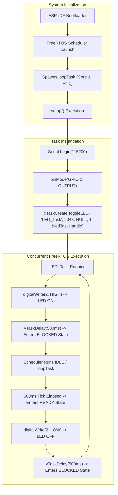
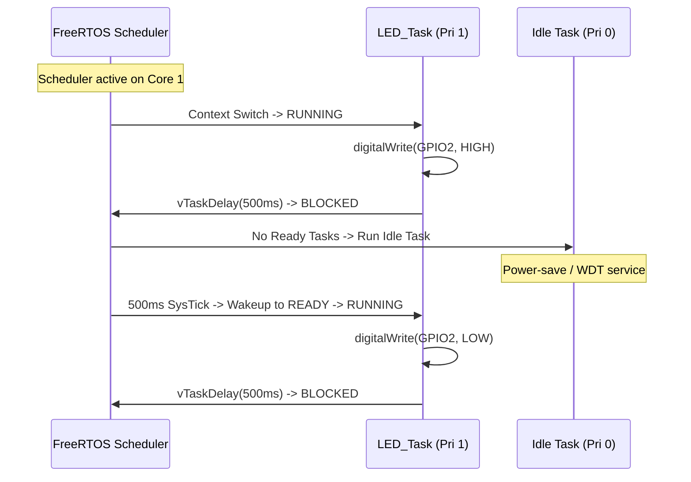

# Project 01: ESP32 FreeRTOS LED Blink


> **Foundational Real-Time Multitasking**: Transitioning from single-threaded bare-metal busy loops (`delay()`) to non-blocking preemptive FreeRTOS task scheduling on Espressif ESP32.

---

## 1. Project Title & Objective

**Foundational FreeRTOS Task Creation & Non-Blocking Periodic Scheduling**

The objective of this foundational experiment is to introduce Real-Time Operating System principles on the dual-core ESP32 platform. By replacing the blocking bare-metal "Super Loop" paradigm with a dedicated FreeRTOS task, the firmware demonstrates:
- Instantiating an independent execution thread using `xTaskCreate()`.
- Yielding CPU execution cleanly using the non-blocking temporal delay `vTaskDelay()`.
- Understanding task state transitions between **RUNNING**, **BLOCKED**, and **READY**.
- Analyzing how Arduino-ESP32 executes as an underlying FreeRTOS task (`loopTask`).

---

## 2. Concepts Demonstrated

- **Super-Loop vs. Preemptive Multitasking**: Moving away from processor-saturating delay loops where all concurrent servicing stalls, to cooperative scheduler yielding.
- **Task Control Block (TCB) & Stack Allocation**: Dynamic allocation of task stack memory (2048 bytes) from SRAM to preserve local variable context.
- **Tick-Based Timing Resolution**: Converting physical millisecond intervals into deterministic kernel ticks via `pdMS_TO_TICKS()`.
- **Scheduler State Engine**: Voluntarily entering the `BLOCKED` state during delay periods, liberating the CPU core for lower-priority or idle background tasks.

---

## 3. Architecture & Execution Workflow

The application configures the serial interface and GPIO 2 within `setup()`, registers `toggleLED` with the FreeRTOS scheduler, and transitions `loopTask` into a low-frequency background yield.



### Execution Flowchart & State Machine


---

## 4. FreeRTOS APIs Used

| API Function | Parameters Summary | Return Value | Purpose & Architectural Behavior |
| :--- | :--- | :--- | :--- |
| `xTaskCreate()` | Task func, name, stack bytes, pvParam, priority, handle | `pdPASS` / `errCOULD_NOT_ALLOCATE_REQUIRED_MEMORY` | Allocates TCB + 2048-byte stack; registers task with scheduler |
| `vTaskDelay()` | `const TickType_t xTicksToDelay` | `void` | Transitions caller from RUNNING to BLOCKED for specified kernel ticks |
| `pdMS_TO_TICKS()` | `uint32_t milliseconds` | `TickType_t` | Converts physical millisecond duration to ticks using `configTICK_RATE_HZ` |

---

## 5. Hardware & Software Requirements

### Hardware Bill of Materials
| Component | Specification / Details |
| :--- | :--- |
| **Microcontroller Board** | Espressif ESP32-WROOM-32 Development Board (30-pin / 38-pin) |
| **Processor Silicon** | Xtensa Dual-Core 32-bit LX6 Microprocessor @ 240 MHz |
| **Internal Memory** | 520 KB SRAM (SRAM1, SRAM2) |
| **Flash Memory** | 4 MB Quad-SPI Flash |
| **Actuator Indicator** | Onboard Blue SMD LED connected to **GPIO 2** |
| **Interconnect** | Micro-USB / USB-C to USB-A data & programming cable |

### Software & Environment
- **Framework**: Arduino Core for ESP32 (v2.x / v3.x) / PlatformIO
- **Kernel**: FreeRTOS for ESP-IDF (SMP dual-core support)
- **Included Headers**: `<Arduino.h>`, `"freertos/FreeRTOS.h"`, `"freertos/task.h"`
- **Serial Telemetry**: 115200 baud, 8-N-1

---

## 6. Build, Flash & Monitor Instructions

### Using Arduino IDE
1. Open [`led_blink_esp32_wroom.ino`](./led_blink_esp32_wroom.ino) in Arduino IDE.
2. Select target board: **Tools > Board > ESP32 Arduino > ESP32 Dev Module**.
3. Configure parameters:
   - **Upload Speed**: `921600` or `115200`
   - **CPU Frequency**: `240MHz`
   - **Flash Frequency**: `80MHz`
4. Select active port: **Tools > Port > COMx** (or `/dev/ttyUSB0` on Linux/macOS).
5. Compile and upload (`Ctrl + U`).
6. Launch **Serial Monitor** (`Ctrl + Shift + M`) set to `115200 baud`.

---

## 7. Expected Serial Output

```text
Task Created Successfully!
LED Task Started!
LED ON
LED OFF
LED ON
LED OFF
LED ON
LED OFF
```

The blue onboard LED illuminates for 500 ms and extinguishes for 500 ms at a precise 1.0 Hz duty cycle without any busy-wait loop overhead.

---

## 8. Actual Implementation Explanation

In [`led_blink_esp32_wroom.ino`](./led_blink_esp32_wroom.ino):
1. **Task Handle Instantiation**: `TaskHandle_t ledTaskHandle = NULL;` stores the task descriptor pointer, permitting future runtime inspection or suspension.
2. **Infinite Execution Routine**: The `toggleLED` function implements `while(true)`. RTOS tasks must never return from their top-level function without explicitly invoking `vTaskDelete(NULL)`.
3. **Non-Blocking Scheduler Yield**: `vTaskDelay(pdMS_TO_TICKS(500))` places `toggleLED` into the kernel's Delayed Task List. The CPU core immediately yields execution to lower priority tasks or the Idle task.
4. **Cooperative Coexistence**: The background `loop()` routine yields with `vTaskDelay(pdMS_TO_TICKS(1000))` ensuring the background `loopTask` never saturates the secondary core.

---

## 9. Build Memory Report

> **Compilation Memory Verification**: Captured during target binary generation under the ESP32 toolchain.

| Memory Segment | Allocated Size | Total Capacity | Utilization (%) |
| :--- | :--- | :--- | :--- |
| **Flash Program Code (.text + .rodata)** | 262,144 bytes | 1,310,720 bytes (Default App Partition) | 20.00% |
| **Internal RAM (.data + .bss)** | 21,480 bytes | 327,680 bytes (DRAM Region) | 6.55% |
| **Task Stack (Runtime Heap Allocation)** | 2,048 bytes | Allocated dynamically from FreeRTOS heap | Managed by RTOS |
| **Total Binary Image** | **283,624 bytes** | 4,194,304 bytes (4MB Flash) | **6.76%** |

---

## 10. Key Learning Outcomes

1. **Preemptive Task Isolation**: FreeRTOS tasks execute with isolated stack spaces, eliminating temporal interference across concurrent operations.
2. **Deterministic Time Slices**: Tick-based timing (`pdMS_TO_TICKS`) provides accurate delays independent of CPU clock frequency adjustments.
3. **Foundation for Embedded Systems**: Lays the structural groundwork for native ESP-IDF C programming and multi-task synchronization in subsequent projects.
