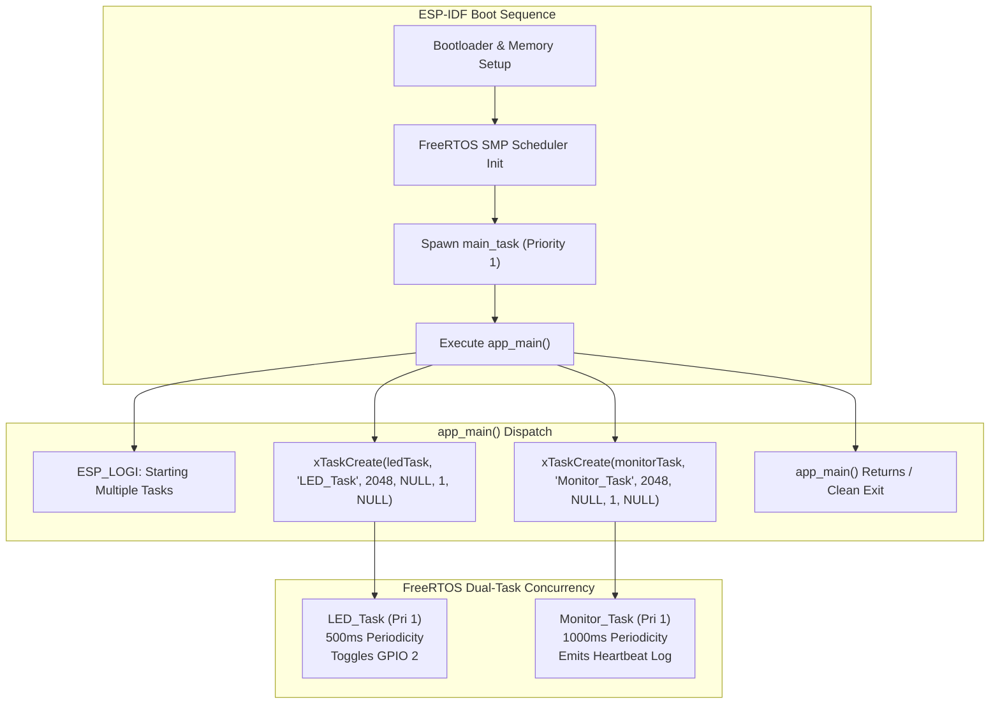
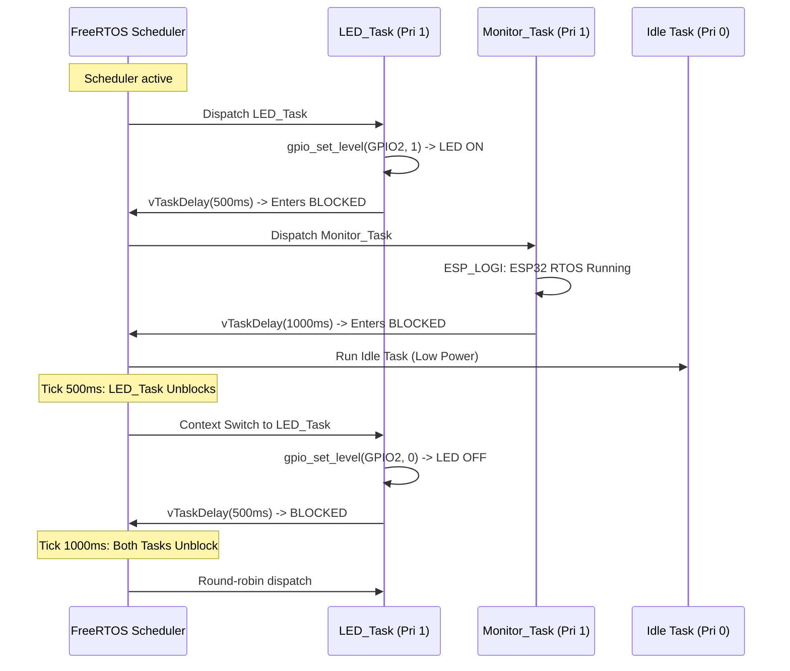

# Project 02: Native ESP-IDF Multiple FreeRTOS Tasks


> **Native ESP-IDF Firmware Engineering**: Transitioning from Arduino abstraction to native C development with dual independent FreeRTOS tasks, direct peripheral hardware drivers, and structured logging.

---

## 1. Project Title & Objective

**Concurrent Multi-Task Scheduling & Native Peripheral Control on ESP-IDF**

The objective of this project is to establish professional, production-grade firmware architecture using the Espressif IoT Development Framework (ESP-IDF v6.1). Moving past the Arduino abstraction, this project implements:
- Direct system initialization via `app_main()` entry point.
- Creating and managing two concurrent FreeRTOS tasks (`ledTask` and `monitorTask`) at equal priority (Priority 1).
- Direct hardware register manipulation using the ESP-IDF GPIO driver (`driver/gpio.h`).
- Structured asynchronous diagnostic telemetry with the ESP logging system (`esp_log.h`).
- Evaluating round-robin preemptive time-slicing between equal-priority tasks.

---

## 2. Concepts Demonstrated

- **Native Entry Point (`app_main`)**: Execution begins in a temporary initialization task created by ESP-IDF system boot, which spawns worker tasks and safely deletes itself or terminates.
- **Equal-Priority Time Slicing**: When multiple tasks share the same numerical priority, FreeRTOS executes round-robin scheduling, sharing CPU time slices seamlessly.
- **Hardware Abstraction via Native Drivers**: Utilizing `gpio_reset_pin()`, `gpio_set_direction()`, and `gpio_set_level()` for direct, zero-overhead register configuration.
- **Tag-Based Logging Subsystem**: Replacing unbuffered UART printing with thread-safe `ESP_LOGI` formatting, incorporating timestamps and tag filtering.

---

## 3. Architecture & Execution Workflow

The ESP-IDF bootloader initializes hardware clocks and memory, launches the FreeRTOS scheduler, and invokes `app_main()`. Two concurrent tasks are spawned:



### Execution Timeline & Context Switching


---

## 4. FreeRTOS APIs Used

| API / Driver Function | Header File | Parameters Summary | Purpose & Architectural Behavior |
| :--- | :--- | :--- | :--- |
| `xTaskCreate()` | `"freertos/task.h"` | Task entry, name, stack depth, pvParam, priority, handle | Spawns thread with private TCB and 2048-byte stack frame |
| `vTaskDelay()` | `"freertos/task.h"` | `const TickType_t xTicksToDelay` | Places calling task in BLOCKED state until delay period elapses |
| `pdMS_TO_TICKS()` | `"freertos/FreeRTOS.h"` | `uint32_t milliseconds` | Converts time to kernel ticks based on `configTICK_RATE_HZ` |
| `gpio_reset_pin()` | `"driver/gpio.h"` | `gpio_num_t gpio_num` | Resets pin matrix, disables pull-ups/pull-downs |
| `gpio_set_direction()` | `"driver/gpio.h"` | `gpio_num_t gpio_num, gpio_mode_t mode` | Configures pin as `GPIO_MODE_OUTPUT` |
| `gpio_set_level()` | `"driver/gpio.h"` | `gpio_num_t gpio_num, uint32_t level` | Sets physical output pin level (0 or 1) |
| `ESP_LOGI()` | `"esp_log.h"` | `TAG, format, ...` | Emits timestamped informational message to UART |

---

## 5. Hardware & Software Requirements

### Hardware Specifications
| Component | Specification / Details |
| :--- | :--- |
| **Microcontroller Board** | Espressif ESP32-WROOM-32 Development Board |
| **Silicon Architecture** | Xtensa Dual-Core 32-bit LX6 @ 240 MHz |
| **Internal Memory** | 520 KB SRAM (organized into IRAM and DRAM) |
| **Flash Memory** | 4 MB Quad-SPI Flash |
| **Actuator Indicator** | Onboard Blue SMD LED connected to **GPIO 2** |
| **Host Serial Port** | COM12 (or host system UART port) @ 115200 baud |

### Software & Toolchain
- **Framework**: Espressif ESP-IDF v6.1
- **Build System**: CMake 3.22+ and Ninja build backend
- **Compiler**: `xtensa-esp-elf-gcc`
- **Configuration**: `sdkconfig` defaults with FreeRTOS 1000 Hz tick rate

---

## 6. Build, Flash & Monitor Instructions

### Environment Setup & Compilation
1. Open terminal with ESP-IDF v6.1 environment initialized:
   ```powershell
   # Windows PowerShell
   . $HOME/esp/esp-idf/export.ps1
   ```
2. Navigate to project directory:
   ```bash
   cd 02_ESP32_Native_ESP_IDF_Multiple_Tasks
   ```
3. Set target microcontroller:
   ```bash
   idf.py set-target esp32
   ```
4. Build firmware binary:
   ```bash
   idf.py build
   ```
5. Flash firmware and open serial monitor:
   ```bash
   idf.py -p COM12 flash monitor
   ```
   *(To exit serial monitor, press `Ctrl + ]`)*.

---

## 7. Expected Serial Output

```text
I (324) RTOS_DEMO: Starting Multiple RTOS Tasks
I (334) RTOS_DEMO: LED ON
I (334) MONITOR: ESP32 RTOS Running
I (834) RTOS_DEMO: LED OFF
I (1334) RTOS_DEMO: LED ON
I (1334) MONITOR: ESP32 RTOS Running
I (1834) RTOS_DEMO: LED OFF
I (2334) RTOS_DEMO: LED ON
I (2334) MONITOR: ESP32 RTOS Running
```

---

## 8. Actual Implementation Explanation

In [`main/main.c`](./main/main.c):
1. **Target Pin Configuration**: `LED_PIN` is designated as `GPIO_NUM_2`. Prior to toggling, `gpio_reset_pin()` clears alternate functions, and `gpio_set_direction()` designates the pad for push-pull output.
2. **`ledTask` Timing**: Operates with a 500ms half-period (`pdMS_TO_TICKS(500)`), yielding a 1.0 Hz total toggle cycle.
3. **`monitorTask` Timing**: Operates with a 1000ms period (`pdMS_TO_TICKS(1000)`), emitting a diagnostic heartbeat via `ESP_LOGI("MONITOR", "ESP32 RTOS Running")`.
4. **Equal Priority Resolution**: Because both tasks share Priority 1, neither task starves the other; context switches occur deterministically whenever a delay primitive is invoked.

---

## 9. Build Memory Report

> **Compilation Memory Verification**: Build metrics generated under ESP-IDF v6.1 targeting the ESP32.

| Memory Segment | Allocated Size | Total Capacity | Utilization (%) |
| :--- | :--- | :--- | :--- |
| **Flash Code (.text)** | 55,642 bytes | - | - |
| **IRAM (Instruction RAM)** | 44,127 bytes | 131,072 bytes | 33.67% |
| **Flash Data (.rodata)** | 34,348 bytes | - | - |
| **DRAM (Data RAM)** | 13,650 bytes | 180,736 bytes | 7.55% |
| **RTC SLOW** | 64 bytes | 8,192 bytes | 0.78% |
| **Total Binary Image** | **147,767 bytes** | 4,194,304 bytes (4MB Flash) | **3.52%** |

---

## 10. Key Learning Outcomes

1. **Native ESP-IDF Advantages**: Elimination of Arduino framework overhead results in a smaller, deterministic codebase with direct hardware access.
2. **True Multitasking**: Concurrent execution of peripheral control and diagnostic telemetry with zero interference or code entanglement.
3. **Foundation for Advanced Synchronization**: Demonstrates the baseline architecture necessary for implementing Queues (Project 04), Semaphores (Project 05), and Mutexes (Project 06).
