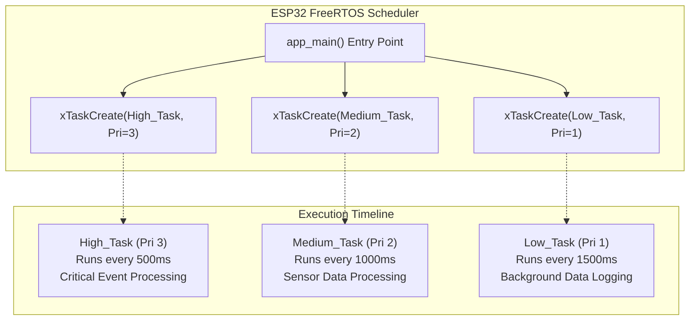
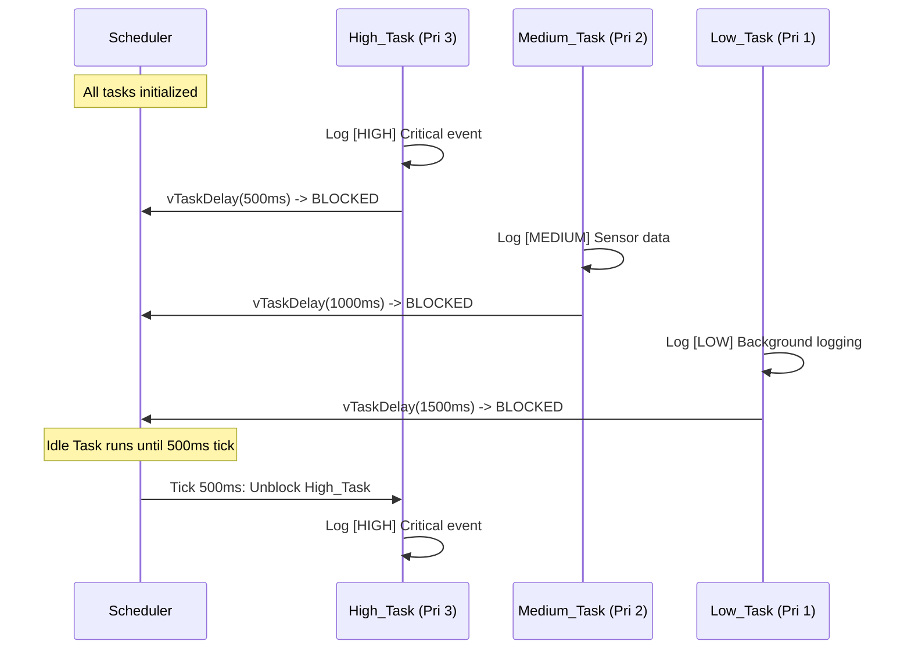
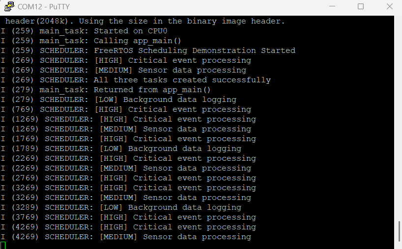

# Project 03: Task Scheduling & Priorities


## 1. Project Title & Objective

**Deterministic Multi-Task Priority Scheduling on ESP32 FreeRTOS**

The objective of this project is to implement and evaluate preemptive, priority-driven real-time task scheduling under FreeRTOS on the ESP32 microcontroller. The firmware creates three concurrent tasks running at distinct numerical priority levels (High, Medium, and Low) to demonstrate priority-based preemption, non-blocking time-sharing with `vTaskDelay()`, and deterministic task starvation avoidance.

---

## 2. Concepts Demonstrated

- **Priority-Driven Preemptive Scheduling**: FreeRTOS assigns the highest priority READY task to an available core.
- **Fixed-Priority Preemption**: When a higher-priority task transitions from BLOCKED to READY (delay expires), it immediately preempts lower-priority tasks.
- **Task Delay Mechanism (`vTaskDelay`)**: Voluntarily relinquishing the CPU by transitioning to the BLOCKED state, allowing lower-priority tasks to execute deterministically without busy-waiting.
- **Starvation Avoidance**: Structuring periodic workloads so higher-priority tasks spend sufficient time in the BLOCKED state, guaranteeing CPU time slices for lower-priority background tasks.

---

## 3. Architecture & Execution Workflow

The application spawns three distinct tasks from `app_main()` with varying priorities and periodicities:



### Execution Flowchart


---

## 4. FreeRTOS APIs Used

| API Function | Header | Description & Purpose |
| :--- | :--- | :--- |
| `xTaskCreate()` | `freertos/task.h` | Allocates task stack, TCB, priority, and registers task with scheduler |
| `vTaskDelay()` | `freertos/task.h` | Places the calling task into BLOCKED state for a specified number of system ticks |
| `pdMS_TO_TICKS()` | `freertos/FreeRTOS.h` | Macro converting physical milliseconds to FreeRTOS tick counts based on `configTICK_RATE_HZ` |
| `ESP_LOGI()` | `esp_log.h` | Thread-safe formatted informational logging over the UART console |

---

## 5. Hardware & Software Requirements

- **Microcontroller**: Espressif ESP32-WROOM-32 (Xtensa dual-core @ 240 MHz)
- **Host Interface**: USB-to-UART bridge (CP2102 / CH340 / FTDI)
- **Framework**: ESP-IDF v6.1 (Ninja & CMake build system)
- **Terminal Emulator**: PuTTY, minicom, or `idf.py monitor` (115200 baud, 8-N-1)

---

## 6. Build, Flash & Monitor Instructions

Run the following commands inside this project directory:

```bash
# 1. Set the target to ESP32
idf.py set-target esp32

# 2. Build the project firmware
idf.py build

# 3. Flash to the development board (replace COMx with your port)
idf.py -p COM12 flash

# 4. Open serial monitor
idf.py -p COM12 monitor
```

To exit the monitor, press `Ctrl+]`.

---

## 7. Expected Serial Output

### Hardware Serial Capture
The following PuTTY terminal log was captured during hardware validation:



### Log Transcript (Illustrative excerpt matching firmware execution)
```text
I (314) SCHEDULER: FreeRTOS Scheduling Demonstration Started
I (324) SCHEDULER: All three tasks created successfully
I (334) SCHEDULER: [HIGH] Critical event processing
I (344) SCHEDULER: [MEDIUM] Sensor data processing
I (354) SCHEDULER: [LOW] Background data logging
I (834) SCHEDULER: [HIGH] Critical event processing
I (1334) SCHEDULER: [HIGH] Critical event processing
I (1344) SCHEDULER: [MEDIUM] Sensor data processing
I (1834) SCHEDULER: [HIGH] Critical event processing
I (1854) SCHEDULER: [LOW] Background data logging
I (2334) SCHEDULER: [HIGH] Critical event processing
I (2344) SCHEDULER: [MEDIUM] Sensor data processing
```

---

## 8. Actual Implementation Explanation

In [`main/main.c`](./main/main.c):
1. **Priority Hierarchy**: Three macros define explicit priorities:
   - `HIGH_PRIORITY = 3`: Dedicated to time-critical events (`highPriorityTask`), executing every 500ms.
   - `MEDIUM_PRIORITY = 2`: Allocated to periodic sensor acquisition (`mediumPriorityTask`), executing every 1000ms.
   - `LOW_PRIORITY = 1`: Reserved for telemetry and background data persistence (`lowPriorityTask`), executing every 1500ms.
2. **Deterministic Preemption**: When the 500ms delay for `highPriorityTask` completes, the scheduler immediately suspends any executing lower priority task (such as `lowPriorityTask`) to service the high-priority workload immediately.
3. **Cooperative Blocking**: Every task calls `vTaskDelay(pdMS_TO_TICKS(n))` rather than a busy-loop delay. This releases CPU execution time back to the scheduler, preventing CPU saturation.

---

## 9. Build Memory Report

> **Note**: This is a verified build-time memory report generated during compilation. It reflects static section allocations in target flash and RAM binaries. Runtime heap usage and dynamic task stacks are managed separately by the FreeRTOS heap.

| Memory Segment | Allocated Size | Total Capacity | Utilization (%) |
| :--- | :--- | :--- | :--- |
| **Flash Code** | 51,894 bytes | - | - |
| **IRAM** | 44,031 bytes | 131,072 bytes | 33.59% |
| **Flash Data** | 35,548 bytes | - | - |
| **DRAM** | 13,618 bytes | 180,736 bytes | 7.53% |
| **RTC SLOW** | 64 bytes | 8,192 bytes | 0.78% |
| **Total Binary Image** | **142,531 bytes** | - | - |

---

## 10. Key Learning Outcomes

1. **Preemption Mechanics**: FreeRTOS uses priority numbers where higher numbers denote higher urgency; higher priority tasks preempt lower priority ones immediately when unblocked.
2. **Context Switching Discipline**: Tasks must yield using blocking primitives (`vTaskDelay`, semaphores, queues) to avoid starving lower-priority tasks on the same core.
3. **Predictable Latency**: Critical operations mapped to high-priority tasks maintain deterministic response times regardless of background system workload.
