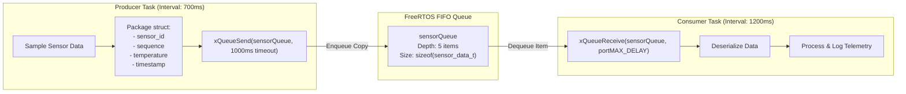
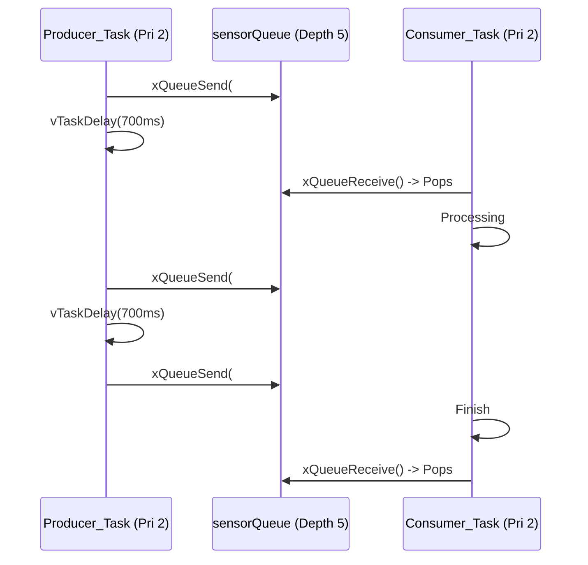
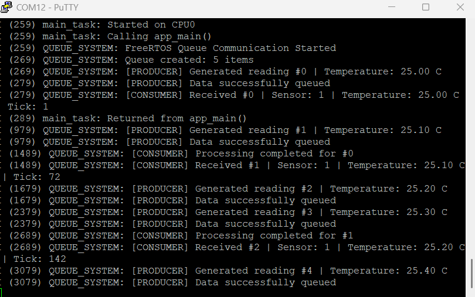

# Project 04: Queue-Based Producer–Consumer System


## 1. Project Title & Objective

**Safe Inter-Task Communication (IPC) via FreeRTOS Queues on ESP32**

The objective of this project is to implement a thread-safe, decoupled producer–consumer architecture using FreeRTOS message queues. The application models a telemetry processing pipeline where an acquisition task passes structured sensor telemetry packets through a FIFO buffer to a slower consumer processing task, illustrating queue buffering, copy-by-value semantics, and backpressure handling.

---

## 2. Concepts Demonstrated

- **Thread-Safe Inter-Task Communication**: Using FreeRTOS queues for synchronization and data exchange without race conditions.
- **Copy-by-Value Semantics**: FreeRTOS queues duplicate the entire data structure into kernel buffer storage, eliminating dangling pointer issues and data corruption across task boundaries.
- **Rate Mismatch & Buffering**: Demonstrating a producer running faster (700ms interval) than the consumer (1200ms processing time), exercising queue absorption and backpressure timeouts.
- **Blocking on Empty & Full Queues**: Consumer blocks efficiently on `portMAX_DELAY` until data arrives; Producer blocks up to 1000ms if the queue is full before flagging a warning.

---

## 3. Architecture & Execution Workflow

The system comprises a 5-element FIFO queue and two concurrent tasks operating at equal priority (2):



### Producer-Consumer Timing & Queue States


---

## 4. FreeRTOS APIs Used

| API Function | Header | Description & Purpose |
| :--- | :--- | :--- |
| `xQueueCreate()` | `freertos/queue.h` | Allocates queue control block and storage buffer in RAM |
| `xQueueSend()` | `freertos/queue.h` | Copies data struct into the queue tail with configurable timeout |
| `xQueueReceive()` | `freertos/queue.h` | Copies data out of queue head and removes it; blocks if queue is empty |
| `xTaskGetTickCount()` | `freertos/task.h` | Queries current system uptime in ticks for telemetry timestamping |
| `xTaskCreate()` | `freertos/task.h` | Spawns producer and consumer worker tasks |
| `vTaskDelay()` | `freertos/task.h` | Non-blocking execution delays for simulated sensor intervals and workload |

---

## 5. Hardware & Software Requirements

- **Microcontroller**: Espressif ESP32-WROOM-32
- **Host Interface**: USB-to-UART bridge (115200 baud, 8-N-1)
- **Framework**: ESP-IDF v6.1
- **Terminal Emulator**: PuTTY or `idf.py monitor`

---

## 6. Build, Flash & Monitor Instructions

Run from within the project directory:

```bash
# 1. Target configuration
idf.py set-target esp32

# 2. Build firmware
idf.py build

# 3. Flash to ESP32
idf.py -p COM12 flash

# 4. Monitor serial logs
idf.py -p COM12 monitor
```

Press `Ctrl+]` to exit monitor.

---

## 7. Expected Serial Output

### Hardware Serial Capture
Captured via PuTTY terminal on physical ESP32-WROOM-32:



### Log Transcript (Illustrative excerpt matching firmware execution)
```text
I (314) QUEUE_SYSTEM: FreeRTOS Queue Communication Started
I (314) QUEUE_SYSTEM: Queue created: 5 items
I (324) QUEUE_SYSTEM: [PRODUCER] Generated reading #0 | Temperature: 25.00 C
I (324) QUEUE_SYSTEM: [PRODUCER] Data successfully queued
I (334) QUEUE_SYSTEM: [CONSUMER] Received #0 | Sensor: 1 | Temperature: 25.00 C | Tick: 32
I (1024) QUEUE_SYSTEM: [PRODUCER] Generated reading #1 | Temperature: 25.10 C
I (1024) QUEUE_SYSTEM: [PRODUCER] Data successfully queued
I (1534) QUEUE_SYSTEM: [CONSUMER] Processing completed for #0
I (1534) QUEUE_SYSTEM: [CONSUMER] Received #1 | Sensor: 1 | Temperature: 25.10 C | Tick: 102
I (1724) QUEUE_SYSTEM: [PRODUCER] Generated reading #2 | Temperature: 25.20 C
I (1724) QUEUE_SYSTEM: [PRODUCER] Data successfully queued
```

---

## 8. Actual Implementation Explanation

In [`main/main.c`](./main/main.c):
1. **Telemetry Data Structure**:
   ```c
   typedef struct {
       int sensor_id;
       int sequence;
       float temperature;
       TickType_t timestamp;
   } sensor_data_t;
   ```
2. **Buffer Sizing**: The queue is initialized with depth 5 (`xQueueCreate(5, sizeof(sensor_data_t))`). Because FreeRTOS stores elements internally, data allocated on the producer's local stack can safely go out of scope without invalidating consumer memory.
3. **Flow Control**:
   - The producer waits up to `pdMS_TO_TICKS(1000)` if the queue is temporarily saturated.
   - The consumer blocks indefinitely on `portMAX_DELAY`, ensuring zero CPU utilization when no telemetry is pending.

---

## 9. Build Memory Report

> **Note**: This is a verified build-time memory report generated during compilation. It reflects static section allocations in target flash and RAM binaries. Runtime heap usage and dynamic task stacks are managed separately by the FreeRTOS heap.

| Memory Segment | Allocated Size | Total Capacity | Utilization (%) |
| :--- | :--- | :--- | :--- |
| **Flash Code** | 52,402 bytes | - | - |
| **IRAM** | 44,031 bytes | 131,072 bytes | 33.59% |
| **Flash Data** | 35,788 bytes | - | - |
| **DRAM** | 13,618 bytes | 180,736 bytes | 7.53% |
| **RTC SLOW** | 64 bytes | 8,192 bytes | 0.78% |
| **Total Binary Image** | **143,279 bytes** | - | - |

---

## 10. Key Learning Outcomes

1. **Memory Isolation**: FreeRTOS queues pass items by value, providing strong memory safety between asynchronous tasks.
2. **Backpressure Decoupling**: Queue depth buffers bursts in data acquisition, preventing lost samples during consumer processing spikes.
3. **Zero-Overhead Blocking**: Tasks waiting on queues do not consume CPU cycles, automatically letting other system tasks or the idle task run.
