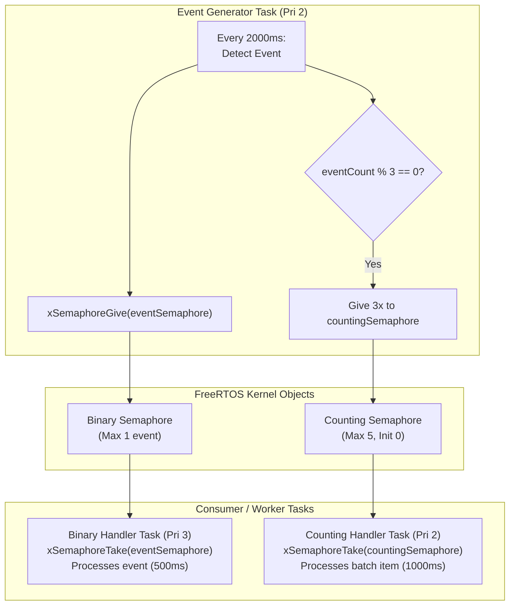
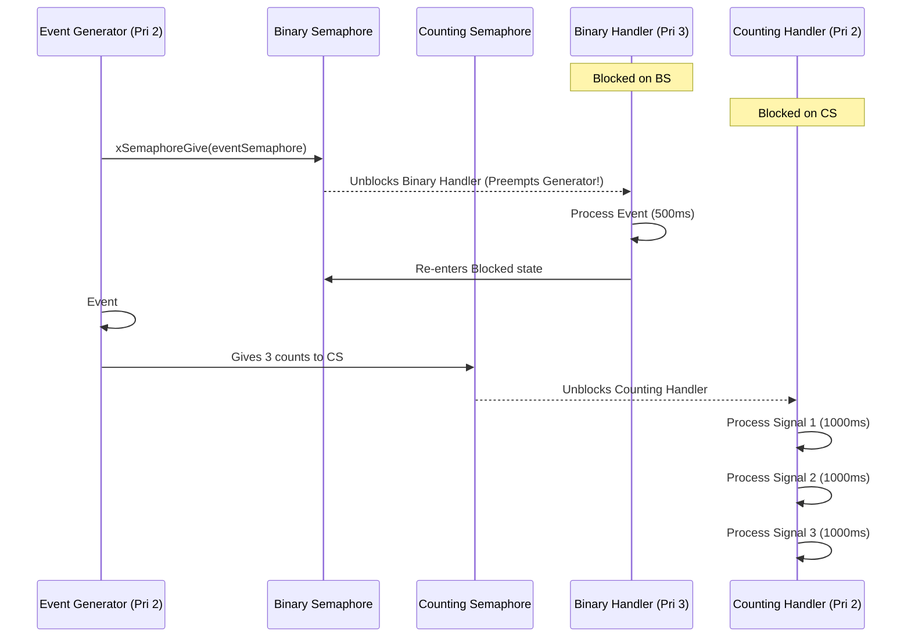
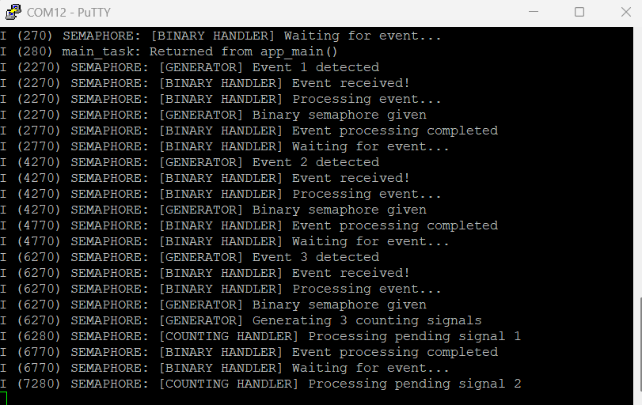

# Project 05: Binary and Counting Semaphores


## 1. Project Title & Objective

**Task Synchronization Using Binary and Counting Semaphores on ESP32**

The objective of this project is to implement and analyze FreeRTOS synchronization primitives. The system coordinates three concurrent tasks using both a **binary semaphore** (for discrete event notification and unblocking) and a **counting semaphore** (for event queuing and tracking multiple pending work units).

---

## 2. Concepts Demonstrated

- **Binary Semaphore Signaling**: Used as an event flag (capacity 1) to synchronize a high-priority handler task with an event generator.
- **Counting Semaphore Management**: Used as an event accumulator (capacity 5, initial count 0) to track bursts of events so pending signals are not dropped.
- **Task Unblocking & Latency**: A higher-priority handler (Priority 3) immediately unblocks and preempts the generator (Priority 2) upon receiving a binary signal.
- **Backpressure & Saturation Detection**: Handling full counting semaphore states gracefully when the event generator produces signals faster than the counting handler can consume.

---

## 3. Architecture & Execution Workflow

The application runs three tasks and manages two synchronization primitives:



### Event Signaling Timeline


---

## 4. FreeRTOS APIs Used

| API Function | Header | Description & Purpose |
| :--- | :--- | :--- |
| `xSemaphoreCreateBinary()` | `freertos/semphr.h` | Creates a binary semaphore initialized in the empty (taken) state |
| `xSemaphoreCreateCounting()` | `freertos/semphr.h` | Creates a counting semaphore with specified max count (5) and initial count (0) |
| `xSemaphoreGive()` | `freertos/semphr.h` | Releases a semaphore token, incrementing count or unblocking waiting task |
| `xSemaphoreTake()` | `freertos/semphr.h` | Acquires a semaphore token, decrementing count or blocking caller |
| `xTaskCreate()` | `freertos/task.h` | Registers tasks with specified priorities and stack allocations |
| `vTaskDelay()` | `freertos/task.h` | Provides non-blocking execution pacing |

---

## 5. Hardware & Software Requirements

- **Microcontroller**: Espressif ESP32-WROOM-32
- **Host Interface**: USB-to-UART bridge (115200 baud, 8-N-1)
- **Framework**: ESP-IDF v6.1
- **Terminal Emulator**: PuTTY or `idf.py monitor`

---

## 6. Build, Flash & Monitor Instructions

Run from within the project directory:

```bash
# 1. Target configuration
idf.py set-target esp32

# 2. Build firmware
idf.py build

# 3. Flash to ESP32
idf.py -p COM12 flash

# 4. Monitor serial logs
idf.py -p COM12 monitor
```

Press `Ctrl+]` to exit monitor.

---

## 7. Expected Serial Output

### Hardware Serial Capture
Captured via PuTTY terminal on physical ESP32-WROOM-32:



### Log Transcript (Illustrative excerpt matching firmware execution)
```text
I (314) SEMAPHORE: FreeRTOS Semaphore Demonstration Started
I (324) SEMAPHORE: Binary and counting semaphores created
I (324) SEMAPHORE: [BINARY HANDLER] Waiting for event...
I (2324) SEMAPHORE: [GENERATOR] Event 1 detected
I (2324) SEMAPHORE: [GENERATOR] Binary semaphore given
I (2324) SEMAPHORE: [BINARY HANDLER] Event received!
I (2334) SEMAPHORE: [BINARY HANDLER] Processing event...
I (2834) SEMAPHORE: [BINARY HANDLER] Event processing completed
I (2834) SEMAPHORE: [BINARY HANDLER] Waiting for event...
I (4324) SEMAPHORE: [GENERATOR] Event 2 detected
I (4324) SEMAPHORE: [GENERATOR] Binary semaphore given
I (4324) SEMAPHORE: [BINARY HANDLER] Event received!
I (6324) SEMAPHORE: [GENERATOR] Event 3 detected
I (6324) SEMAPHORE: [GENERATOR] Binary semaphore given
I (6324) SEMAPHORE: [GENERATOR] Generating 3 counting signals
I (6334) SEMAPHORE: [BINARY HANDLER] Event received!
I (6334) SEMAPHORE: [COUNTING HANDLER] Processing pending signal 1
I (7334) SEMAPHORE: [COUNTING HANDLER] Processing pending signal 2
I (8334) SEMAPHORE: [COUNTING HANDLER] Processing pending signal 3
```

---

## 8. Actual Implementation Explanation

In [`main/main.c`](./main/main.c):
1. **Binary vs Counting Primitives**:
   - `xSemaphoreCreateBinary()` initializes a token in the empty state. It acts strictly as an on/off latch. Even if given multiple times without being taken, its state remains binary (1).
   - `xSemaphoreCreateCounting(5, 0)` initializes a bucket with capacity 5 and count 0. When the generator gives 3 tokens on event #3, all 3 tokens are preserved in the semaphore count.
2. **Preemption Dynamics**:
   - `binaryHandlerTask` is assigned Priority 3, while `eventGeneratorTask` is Priority 2.
   - When the generator invokes `xSemaphoreGive(eventSemaphore)`, the scheduler immediately switches context to `binaryHandlerTask`, achieving near-zero latency event reaction.
3. **Pipelined Consumption**:
   - `countingHandlerTask` loops over `xSemaphoreTake(countingSemaphore, portMAX_DELAY)`. It systematically consumes each pending signal one by one without missing transient events.

---

## 9. Build Memory Report

> **Note**: This is a verified build-time memory report generated during compilation. It reflects static section allocations in target flash and RAM binaries. Runtime heap usage and dynamic task stacks are managed separately by the FreeRTOS heap.

| Memory Segment | Allocated Size | Total Capacity | Utilization (%) |
| :--- | :--- | :--- | :--- |
| **Flash Code** | 52,358 bytes | - | - |
| **IRAM** | 44,031 bytes | 131,072 bytes | 33.59% |
| **Flash Data** | 36,076 bytes | - | - |
| **DRAM** | 13,626 bytes | 180,736 bytes | 7.54% |
| **RTC SLOW** | 64 bytes | 8,192 bytes | 0.78% |
| **Total Binary Image** | **143,523 bytes** | - | - |

---

## 10. Key Learning Outcomes

1. **Signaling vs Exclusion**: Semaphores are ideal for signaling (`Task A signals Task B`), whereas Mutexes are optimized for resource mutual exclusion with priority inheritance.
2. **Event Buffering**: Counting semaphores prevent event loss during processing spikes by queuing arrival notifications up to the configured limit.
3. **Priority Inversion Avoidance in Signaling**: Giving a higher priority to the consumer/handler ensures the system does not accumulate unbounded event backlogs.
