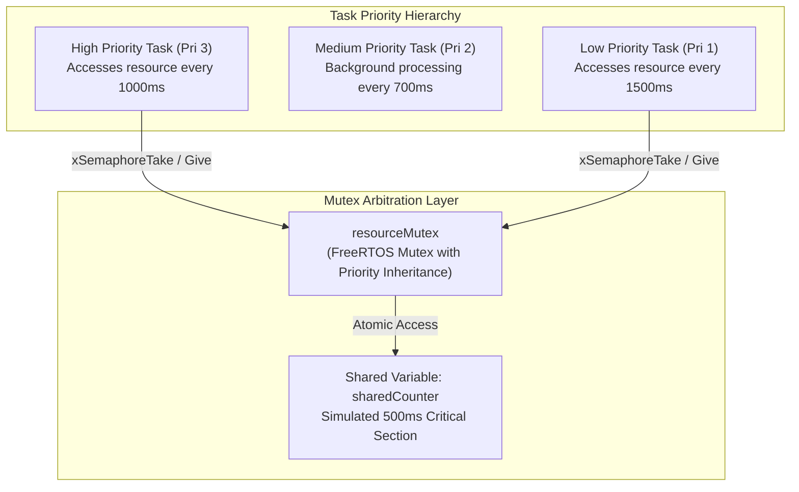
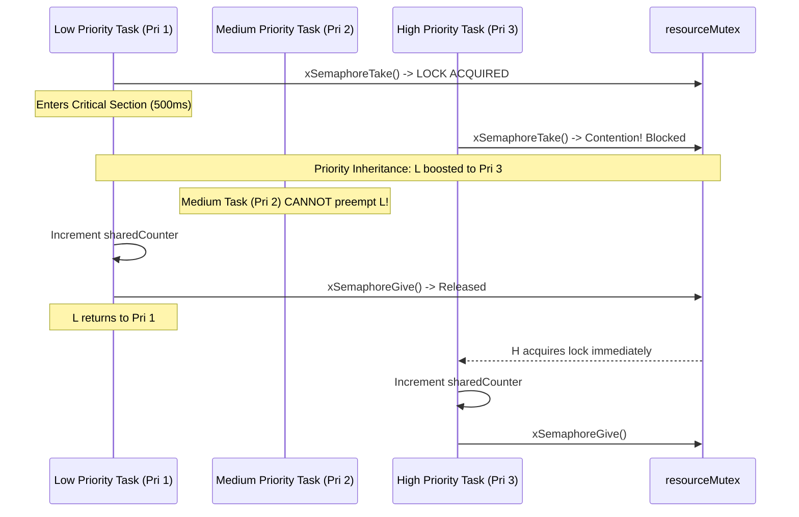
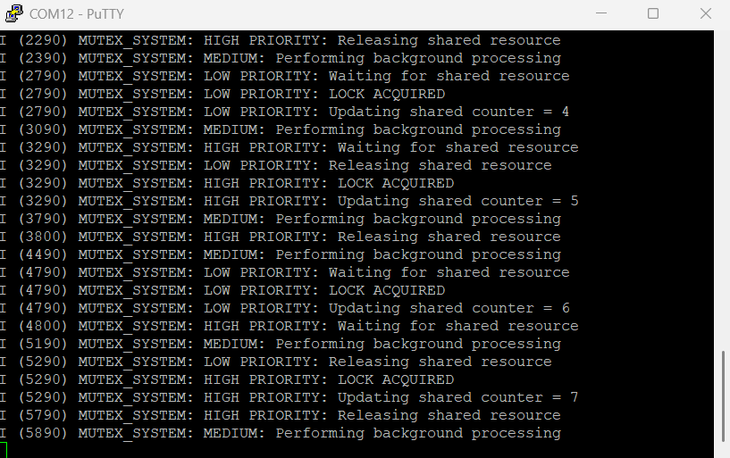

# Project 06: Mutex Resource Management


## 1. Project Title & Objective

**Safe Shared Resource Arbitration and Priority Inheritance Using FreeRTOS Mutexes**

The objective of this project is to implement mutual exclusion (mutex) mechanisms in FreeRTOS to safeguard shared memory structures against race conditions, data corruption, and priority inversion anomalies. The application coordinates high, medium, and low-priority tasks competing for an exclusive shared peripheral/variable resource.

---

## 2. Concepts Demonstrated

- **Mutual Exclusion (Mutex)**: Enforcing strict single-task access to a shared resource during critical code sections.
- **Race Condition Prevention**: Serializing atomic modifications of a global shared counter (`sharedCounter`) accessed concurrently by multiple tasks.
- **Priority Inversion Problem**: An architectural hazard where an intermediate priority task preempts a lower priority task that holds a lock required by a high-priority task.
- **FreeRTOS Priority Inheritance**: The FreeRTOS mutex mechanism automatically boosts the priority of the lock-holding task to match the highest waiting task, mitigating unbounded priority inversion.

---

## 3. Architecture & Execution Workflow

The system architecture features a shared variable guarded by a mutex, accessed by three tasks of varying priorities:



### Mutex Lock Sequence & Contention


---

## 4. FreeRTOS APIs Used

| API Function | Header | Description & Purpose |
| :--- | :--- | :--- |
| `xSemaphoreCreateMutex()` | `freertos/semphr.h` | Allocates a recursive-capable mutex object equipped with priority inheritance |
| `xSemaphoreTake()` | `freertos/semphr.h` | Acquires the mutex lock; blocks calling task if another task holds it |
| `xSemaphoreGive()` | `freertos/semphr.h` | Releases the mutex lock; restores caller's original priority if elevated |
| `xTaskCreate()` | `freertos/task.h` | Instantiates tasks across distinct priority tiers (1, 2, and 3) |
| `vTaskDelay()` | `freertos/task.h` | Simulates real-time workloads and critical-section holding times |

---

## 5. Hardware & Software Requirements

- **Microcontroller**: Espressif ESP32-WROOM-32
- **Host Interface**: USB-to-UART bridge (115200 baud, 8-N-1)
- **Framework**: ESP-IDF v6.1
- **Terminal Emulator**: PuTTY or `idf.py monitor`

---

## 6. Build, Flash & Monitor Instructions

Run from within the project directory:

```bash
# 1. Target configuration
idf.py set-target esp32

# 2. Build firmware
idf.py build

# 3. Flash to ESP32
idf.py -p COM12 flash

# 4. Monitor serial logs
idf.py -p COM12 monitor
```

Press `Ctrl+]` to exit monitor.

---

## 7. Expected Serial Output

### Hardware Serial Capture
Captured via PuTTY terminal on physical ESP32-WROOM-32:



### Log Transcript (Illustrative excerpt matching firmware execution)
```text
I (314) MUTEX_SYSTEM: Mutex Resource Management Started
I (324) MUTEX_SYSTEM: Shared resource mutex created
I (324) MUTEX_SYSTEM: HIGH PRIORITY: Waiting for shared resource
I (324) MUTEX_SYSTEM: HIGH PRIORITY: LOCK ACQUIRED
I (334) MUTEX_SYSTEM: HIGH PRIORITY: Updating shared counter = 1
I (344) MUTEX_SYSTEM: MEDIUM: Performing background processing
I (834) MUTEX_SYSTEM: HIGH PRIORITY: Releasing shared resource
I (834) MUTEX_SYSTEM: LOW PRIORITY: Waiting for shared resource
I (834) MUTEX_SYSTEM: LOW PRIORITY: LOCK ACQUIRED
I (844) MUTEX_SYSTEM: LOW PRIORITY: Updating shared counter = 2
I (1044) MUTEX_SYSTEM: MEDIUM: Performing background processing
I (1334) MUTEX_SYSTEM: LOW PRIORITY: Releasing shared resource
I (1334) MUTEX_SYSTEM: HIGH PRIORITY: Waiting for shared resource
I (1334) MUTEX_SYSTEM: HIGH PRIORITY: LOCK ACQUIRED
I (1344) MUTEX_SYSTEM: HIGH PRIORITY: Updating shared counter = 3
```

---

## 8. Actual Implementation Explanation

In [`main/main.c`](./main/main.c):
1. **Critical Section Encapsulation**:
   The helper function `accessSharedResource(const char *taskName)` encapsulates the lock acquisition, modification of `sharedCounter`, simulated 500ms workload delay, and lock release.
2. **Mutual Exclusion Assurance**:
   Because `xSemaphoreTake(resourceMutex, portMAX_DELAY)` is checked before writing to `sharedCounter`, at no point can both High Priority and Low Priority tasks manipulate the shared state simultaneously.
3. **Difference from Binary Semaphores**:
   Unlike a binary semaphore, a FreeRTOS mutex:
   - Tracks lock ownership (the task that takes the mutex must be the one to give it).
   - Dynamically elevates the holding task's priority if a higher-priority task attempts to acquire the lock.

---

## 9. Build Memory Report

> **Note**: This is a verified build-time memory report generated during compilation. It reflects static section allocations in target flash and RAM binaries. Runtime heap usage and dynamic task stacks are managed separately by the FreeRTOS heap.

| Memory Segment | Allocated Size | Total Capacity | Utilization (%) |
| :--- | :--- | :--- | :--- |
| **Flash Code** | 52,126 bytes | - | - |
| **IRAM** | 44,031 bytes | 131,072 bytes | 33.59% |
| **Flash Data** | 35,724 bytes | - | - |
| **DRAM** | 13,626 bytes | 180,736 bytes | 7.54% |
| **RTC SLOW** | 64 bytes | 8,192 bytes | 0.78% |
| **Total Binary Image** | **142,939 bytes** | - | - |

---

## 10. Key Learning Outcomes

1. **Ownership Requirement**: Mutexes are owned objects; releasing an unowned mutex or passing it across an ISR breaks priority inheritance mechanisms.
2. **Priority Inversion Mitigation**: Priority inheritance prevents unbound execution stalls caused by medium-priority tasks starving lock-holding low-priority tasks.
3. **Critical Section Duration**: Tasks must keep critical sections as short as possible to minimize latency jitter for higher-priority system tasks.
