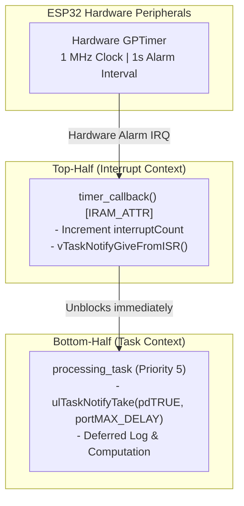
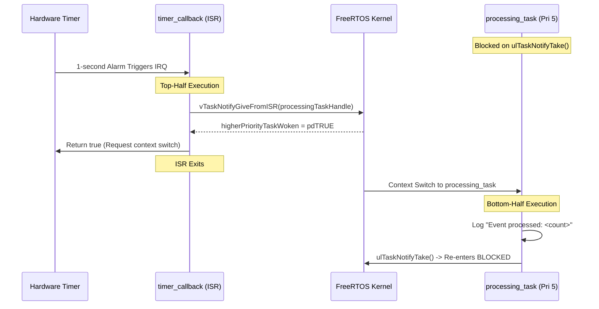
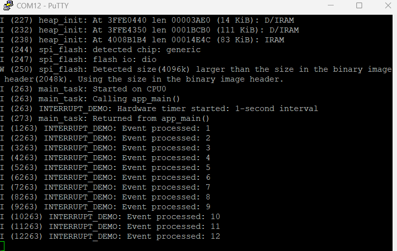

# Project 07: Interrupt-Driven Event Processing


## 1. Project Title & Objective

**Deferred Interrupt Handling Using Hardware GPTimer and Direct-to-Task Notifications on ESP32**

The objective of this project is to implement a robust, high-performance interrupt service routine (ISR) to task communication pattern on ESP32 FreeRTOS. By utilizing hardware General Purpose Timer (GPTimer) alarms and Direct-to-Task Notifications (`vTaskNotifyGiveFromISR`), the project demonstrates deferred interrupt handling ("bottom-half" processing) to keep hardware ISR latency minimal while executing complex processing in task context.

---

## 2. Concepts Demonstrated

- **Deferred Interrupt Processing (Top-Half / Bottom-Half)**: Keeping the hardware ISR minimal (top-half) and deferring data formatting, logging, and application logic to a dedicated task (bottom-half).
- **Direct-to-Task Notifications**: Using FreeRTOS task notifications (`vTaskNotifyGiveFromISR` / `ulTaskNotifyTake`) as a lightweight, zero-RAM alternative to binary semaphores (up to 45% faster context transition).
- **`IRAM_ATTR` ISR Placement**: Placing the interrupt handler into internal instruction RAM (IRAM) to ensure determinism and avoid cache-miss latency during flash access.
- **`FromISR` API Safety & Preemption**: Passing `higherPriorityTaskWoken` to request immediate context switching out of the interrupt directly to the unblocked task.

---

## 3. Architecture & Execution Workflow

The architecture separates hardware timing triggers from application processing:



### Interrupt-to-Task Notification Lifecycle


---

## 4. FreeRTOS & ESP-IDF APIs Used

| API Function | Header | Description & Purpose |
| :--- | :--- | :--- |
| `vTaskNotifyGiveFromISR()` | `freertos/task.h` | Increments notification value of target task and sets context switch flag from ISR |
| `ulTaskNotifyTake()` | `freertos/task.h` | Blocks calling task until notification is received; clears count atomically |
| `gptimer_new_timer()` | `driver/gptimer.h` | Allocates and configures ESP32 64-bit general purpose hardware timer instance |
| `gptimer_register_event_callbacks()` | `driver/gptimer.h` | Registers user ISR callback function with the timer driver |
| `gptimer_set_alarm_action()` | `driver/gptimer.h` | Configures alarm threshold count and auto-reload reload behavior |
| `xTaskCreate()` | `freertos/task.h` | Creates high-priority event handling task (Priority 5) |

---

## 5. Hardware & Software Requirements

- **Microcontroller**: Espressif ESP32-WROOM-32
- **Host Interface**: USB-to-UART bridge (115200 baud, 8-N-1)
- **Framework**: ESP-IDF v6.1 (`esp_driver_gptimer` component)
- **Terminal Emulator**: PuTTY or `idf.py monitor`

---

## 6. Build, Flash & Monitor Instructions

Run from within the project directory:

```bash
# 1. Target configuration
idf.py set-target esp32

# 2. Build firmware
idf.py build

# 3. Flash to ESP32
idf.py -p COM12 flash

# 4. Monitor serial logs
idf.py -p COM12 monitor
```

Press `Ctrl+]` to exit monitor.

---

## 7. Expected Serial Output

### Hardware Serial Capture
Captured via PuTTY terminal on physical ESP32-WROOM-32:



### Log Transcript (Illustrative excerpt matching firmware execution)
```text
I (314) INTERRUPT_DEMO: Hardware timer started: 1-second interval
I (1314) INTERRUPT_DEMO: Event processed: 1
I (2314) INTERRUPT_DEMO: Event processed: 2
I (3314) INTERRUPT_DEMO: Event processed: 3
I (4314) INTERRUPT_DEMO: Event processed: 4
I (5314) INTERRUPT_DEMO: Event processed: 5
I (6314) INTERRUPT_DEMO: Event processed: 6
I (7314) INTERRUPT_DEMO: Event processed: 7
```

---

## 8. Actual Implementation Explanation

In [`main/main.c`](./main/main.c):
1. **Timer Initialization**:
   - `gptimer` is set with `resolution_hz = 1000000` (1 microsecond per tick).
   - Alarm count is set to `1000000` (exact 1-second period) with auto-reload enabled.
2. **ISR Execution Safety**:
   - `timer_callback` is tagged with `IRAM_ATTR` to reside in fast internal RAM.
   - It performs only two operations: increments volatile counter `interruptCount` and issues `vTaskNotifyGiveFromISR`.
   - Returns boolean `higherPriorityTaskWoken == pdTRUE`, instructing the ESP-IDF interrupt dispatcher to immediately switch to `processing_task` on ISR exit.
3. **Deferred Processing**:
   - `processing_task` runs at priority 5. It performs the serial log (`ESP_LOGI`) in task space, where blocking UART calls are safe and do not stall interrupt lines.

---

## 9. Build Memory Report

> **Note**: This is a verified build-time memory report generated during compilation. It reflects static section allocations in target flash and RAM binaries. Runtime heap usage and dynamic task stacks are managed separately by the FreeRTOS heap.

| Memory Segment | Allocated Size | Total Capacity | Utilization (%) |
| :--- | :--- | :--- | :--- |
| **Flash Code** | 53,622 bytes | - | - |
| **IRAM** | 44,395 bytes | 131,072 bytes | 33.87% |
| **Flash Data** | 35,940 bytes | - | - |
| **DRAM** | 13,930 bytes | 180,736 bytes | 7.71% |
| **RTC SLOW** | 64 bytes | 8,192 bytes | 0.78% |
| **Total Binary Image** | **145,015 bytes** | - | - |

---

## 10. Key Learning Outcomes

1. **Top-Half / Bottom-Half Separation**: Never execute slow or blocking calls (such as `ESP_LOGI` or mutex locks) inside an ISR; always signal a task.
2. **Efficiency of Task Notifications**: Direct-to-task notifications consume no dedicated FreeRTOS heap memory and offer reduced latency compared to queues or semaphores.
3. **Deterministic Timers**: Hardware GPTimer provides hardware-precise microsecond timing independent of RTOS tick jitter.
