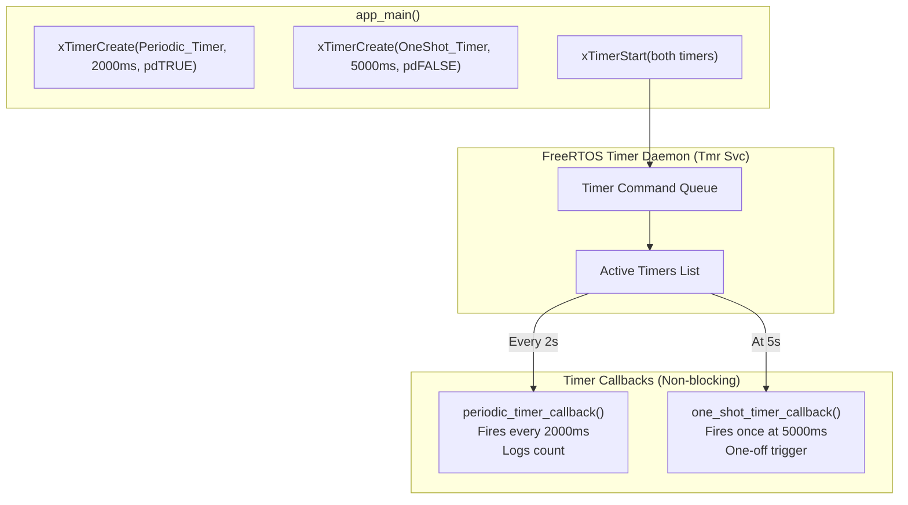
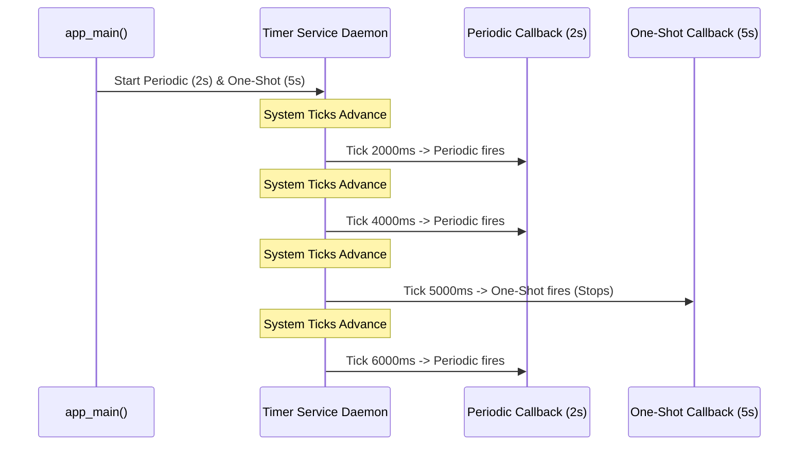
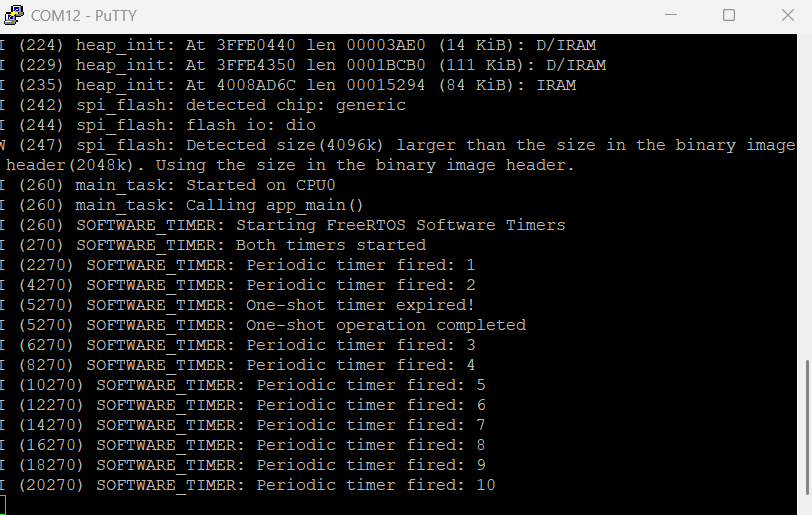

# Project 08: FreeRTOS Software Timers


## 1. Project Title & Objective

**Asynchronous Timing with Periodic and One-Shot FreeRTOS Software Timers on ESP32**

The objective of this project is to implement non-hardware-bound timing routines using the FreeRTOS Software Timer service daemon (`prvTimerTask`). The firmware initializes, starts, and monitors both an auto-reload periodic timer (for continuous heartbeat operations) and a one-shot timer (for delayed single-event execution), avoiding the allocation of dedicated task stacks for simple periodic functions.

---

## 2. Concepts Demonstrated

- **FreeRTOS Software Timer Daemon**: Utilizing the built-in timer service task (`Tmr Svc`) and timer command queue to execute scheduled callbacks without dedicating distinct tasks.
- **Auto-Reload vs One-Shot Timers**: Demonstrating the functional difference between an auto-reloading timer (`pdTRUE`, repeating every 2s) and a single-shot timer (`pdFALSE`, firing once at 5s).
- **Callback Execution Context**: Software timer callbacks execute within the context of the timer service task, meaning they run in task context (not ISR context) but must **never block** or call blocking APIs.
- **Resource Efficiency**: Scheduling multiple time-based triggers without allocating individual 2KB+ task stacks for each periodic operation.

---

## 3. Architecture & Execution Workflow

The timers operate via message passing to the FreeRTOS timer command queue:



### Timer Firing Timeline


---

## 4. FreeRTOS APIs Used

| API Function | Header | Description & Purpose |
| :--- | :--- | :--- |
| `xTimerCreate()` | `freertos/timers.h` | Allocates timer control structure, period, auto-reload flag, and callback |
| `xTimerStart()` | `freertos/timers.h` | Sends start command to timer service command queue |
| `xTimerStop()` | `freertos/timers.h` | Sends stop command to timer service command queue |
| `pdMS_TO_TICKS()` | `freertos/FreeRTOS.h` | Converts milliseconds to tick intervals based on kernel tick rate |
| `vTaskDelay()` | `freertos/task.h` | Paces the main task while daemon manages callbacks |

---

## 5. Hardware & Software Requirements

- **Microcontroller**: Espressif ESP32-WROOM-32
- **Host Interface**: USB-to-UART bridge (115200 baud, 8-N-1)
- **Framework**: ESP-IDF v6.1
- **Terminal Emulator**: PuTTY or `idf.py monitor`

---

## 6. Build, Flash & Monitor Instructions

Run from within the project directory:

```bash
# 1. Target configuration
idf.py set-target esp32

# 2. Build firmware
idf.py build

# 3. Flash to ESP32
idf.py -p COM12 flash

# 4. Monitor serial logs
idf.py -p COM12 monitor
```

Press `Ctrl+]` to exit monitor.

---

## 7. Expected Serial Output

### Hardware Serial Capture
Captured via PuTTY terminal on physical ESP32-WROOM-32:



### Log Transcript (Illustrative excerpt matching firmware execution)
```text
I (314) SOFTWARE_TIMER: Starting FreeRTOS Software Timers
I (324) SOFTWARE_TIMER: Both timers started
I (2324) SOFTWARE_TIMER: Periodic timer fired: 1
I (4324) SOFTWARE_TIMER: Periodic timer fired: 2
I (5324) SOFTWARE_TIMER: One-shot timer expired!
I (5324) SOFTWARE_TIMER: One-shot operation completed
I (6324) SOFTWARE_TIMER: Periodic timer fired: 3
I (8324) SOFTWARE_TIMER: Periodic timer fired: 4
```

---

## 8. Actual Implementation Explanation

In [`main/main.c`](./main/main.c):
1. **Periodic Timer**:
   - Initialized with `pdMS_TO_TICKS(2000)` and `uxAutoReload = pdTRUE`.
   - Fires repeatedly every 2 seconds, incrementing `periodicCount` and logging status.
2. **One-Shot Timer**:
   - Initialized with `pdMS_TO_TICKS(5000)` and `uxAutoReload = pdFALSE`.
   - Expires exactly once at the 5-second mark, outputs confirmation, and automatically transitions to the dormant state without further invocation.
3. **Daemon Safety Rules**:
   - Software timer callbacks execute synchronously inside the Timer Service Task. Neither callback invokes `vTaskDelay()` or blocking queue operations, ensuring that the timer daemon remains responsive to other scheduled timers.

---

## 9. Build Memory Report

> **Note**: This is a verified build-time memory report generated during compilation. It reflects static section allocations in target flash and RAM binaries. Runtime heap usage and dynamic task stacks are managed separately by the FreeRTOS heap.

| Memory Segment | Allocated Size | Total Capacity | Utilization (%) |
| :--- | :--- | :--- | :--- |
| **Flash Code** | 53,622 bytes | - | - |
| **IRAM** | 44,395 bytes | 131,072 bytes | 33.87% |
| **Flash Data** | 35,940 bytes | - | - |
| **DRAM** | 13,930 bytes | 180,736 bytes | 7.71% |
| **RTC SLOW** | 64 bytes | 8,192 bytes | 0.78% |
| **Total Binary Image** | **145,015 bytes** | - | - |

---

## 10. Key Learning Outcomes

1. **Stack Savings**: Software timers eliminate the memory overhead of spawning separate FreeRTOS tasks for simple periodic checks or delayed triggers.
2. **Strict Non-Blocking Rule**: A blocking operation inside any timer callback halts the entire timer service task, delaying all other active timers in the system.
3. **Daemon Configuration**: The timer task priority and queue size are configured via `CONFIG_FREERTOS_TIMER_TASK_PRIORITY` and `CONFIG_FREERTOS_TIMER_QUEUE_LENGTH` in `menuconfig`.
