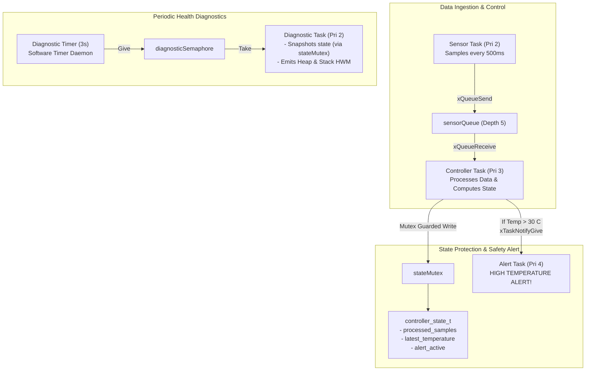
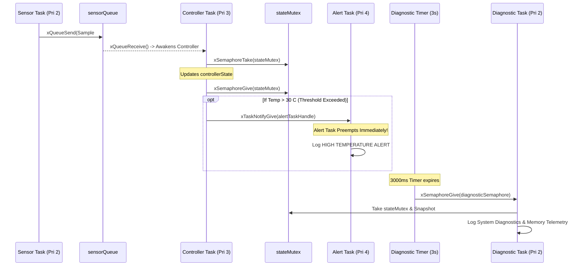
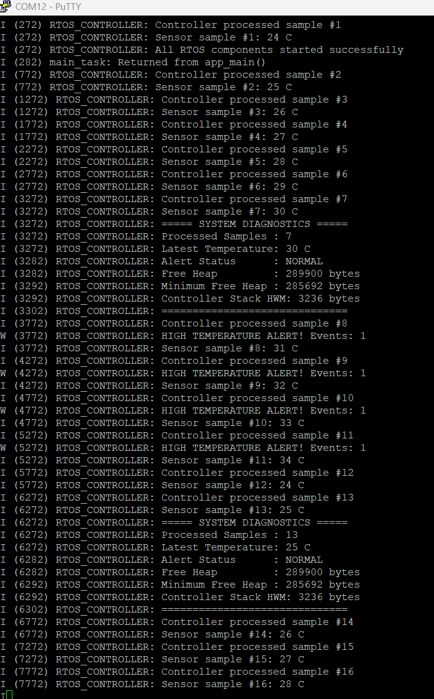

# Project 10: Integrated Real-Time Embedded Controller


## 1. Project Title & Objective

**Full-System Production-Grade Real-Time Embedded Controller on ESP32**

The objective of this capstone project is to synthesize all core FreeRTOS primitives into a complete, concurrent embedded controller architecture. The firmware models an industrial environmental monitoring system combining prioritized tasks, message queues, mutex-guarded shared state, direct-to-task alert notifications, software timer-driven health diagnostics, and runtime memory monitoring.

---

## 2. Concepts Demonstrated

- **Comprehensive FreeRTOS Integration**: Orchestrating Queues, Mutexes, Binary Semaphores, Software Timers, Task Notifications, and Runtime Diagnostics in a single unified architecture.
- **Multi-Tier Priority Architecture**: Structuring a 4-level task hierarchy (Alert: 4, Controller: 3, Diagnostic: 2, Sensor: 2) ensuring immediate responsiveness to hazardous thermal events.
- **Direct-to-Task Emergency Dispatch**: Using `xTaskNotifyGive` to awaken the alert task with sub-microsecond latency upon threshold breach.
- **Timer-Driven Decoupled Diagnostics**: Using a FreeRTOS software timer to periodically trigger an independent diagnostic task via a binary semaphore without blocking the timer daemon.
- **Thread-Safe Shared State**: Safeguarding controller telemetry snapshots via `stateMutex` against concurrent read/write access.

---

## 3. Architecture & Execution Workflow

The complete architecture integrates four tasks, one software timer, and four synchronization/communication primitives:



### Full System Interaction Sequence


---

## 4. FreeRTOS & ESP-IDF APIs Used

| API Function | Header | Description & Purpose |
| :--- | :--- | :--- |
| `xQueueCreate()` / `xQueueSend()` / `xQueueReceive()` | `freertos/queue.h` | Decoupled IPC channel between sensor acquisition and controller logic |
| `xSemaphoreCreateMutex()` / `xSemaphoreTake()` / `xSemaphoreGive()` | `freertos/semphr.h` | Mutual exclusion guarding shared state variables from race conditions |
| `xSemaphoreCreateBinary()` | `freertos/semphr.h` | Event token signaling diagnostic task from software timer callback |
| `xTimerCreate()` / `xTimerStart()` | `freertos/timers.h` | Periodic 3-second timer scheduling diagnostic snapshots |
| `xTaskNotifyGive()` / `ulTaskNotifyTake()` | `freertos/task.h` | High-speed, lightweight emergency alert dispatch |
| `uxTaskGetStackHighWaterMark()` | `freertos/task.h` | Tracks peak stack usage of controller task at runtime |
| `esp_get_free_heap_size()` / `esp_get_minimum_free_heap_size()` | `esp_system.h` | Monitors dynamic heap memory availability and all-time minimum headroom |

---

## 5. Hardware & Software Requirements

- **Microcontroller**: Espressif ESP32-WROOM-32
- **Host Interface**: USB-to-UART bridge (115200 baud, 8-N-1)
- **Framework**: ESP-IDF v6.1 (`esp_system` component)
- **Terminal Emulator**: PuTTY or `idf.py monitor`

---

## 6. Build, Flash & Monitor Instructions

Run from within the project directory:

```bash
# 1. Target configuration
idf.py set-target esp32

# 2. Build firmware
idf.py build

# 3. Flash to ESP32
idf.py -p COM12 flash

# 4. Monitor serial logs
idf.py -p COM12 monitor
```

Press `Ctrl+]` to exit monitor.

---

## 7. Expected Serial Output

### Hardware Serial Capture
Captured via PuTTY terminal on physical ESP32-WROOM-32:



### Log Transcript (Illustrative excerpt matching firmware execution)
```text
I (314) RTOS_CONTROLLER: Starting Integrated RTOS Controller
I (324) RTOS_CONTROLLER: All RTOS components started successfully
I (324) RTOS_CONTROLLER: Sensor sample #1: 24 C
I (324) RTOS_CONTROLLER: Controller processed sample #1
I (824) RTOS_CONTROLLER: Sensor sample #2: 25 C
I (824) RTOS_CONTROLLER: Controller processed sample #2
I (3324) RTOS_CONTROLLER: ===== SYSTEM DIAGNOSTICS =====
I (3324) RTOS_CONTROLLER: Processed Samples : 6
I (3324) RTOS_CONTROLLER: Latest Temperature: 29 C
I (3334) RTOS_CONTROLLER: Alert Status      : NORMAL
I (3334) RTOS_CONTROLLER: Free Heap         : 289124 bytes
I (3344) RTOS_CONTROLLER: Minimum Free Heap : 284300 bytes
I (3354) RTOS_CONTROLLER: Controller Stack HWM: 3120 bytes
I (3364) RTOS_CONTROLLER: ==============================
I (3824) RTOS_CONTROLLER: Sensor sample #8: 31 C
I (3824) RTOS_CONTROLLER: Controller processed sample #8
W (3824) RTOS_CONTROLLER: HIGH TEMPERATURE ALERT! Events: 1
I (4324) RTOS_CONTROLLER: Sensor sample #9: 32 C
I (4324) RTOS_CONTROLLER: Controller processed sample #9
W (4324) RTOS_CONTROLLER: HIGH TEMPERATURE ALERT! Events: 1
```

---

## 8. Actual Implementation Explanation

In [`main/main.c`](./main/main.c):
1. **Multi-Task Synchronization Strategy**:
   - `sensor_task` (Pri 2) acts as the producer, sampling temperature every 500ms and pushing records into `sensorQueue`.
   - `controller_task` (Pri 3) preempts the sensor task as soon as a sample arrives, unpacks the data, locks `stateMutex`, and updates `controllerState`.
2. **Emergency Preemption Path**:
   - If temperature exceeds `TEMP_ALERT_THRESHOLD` (30°C), `controller_task` triggers `xTaskNotifyGive(alertTaskHandle)`.
   - Because `alert_task` runs at **Priority 4** (the highest priority in the system), the scheduler context-switches immediately to `alert_task`, logging the critical warning with zero queuing delay.
3. **Decoupled Diagnostics Engine**:
   - Software timer `diagnosticTimer` triggers every 3000ms. In accordance with FreeRTOS best practices, its callback performs zero heavy lifting, merely giving `diagnosticSemaphore`.
   - `diagnostic_task` unblocks, locks `stateMutex` briefly to take a consistent snapshot, and prints formatted system diagnostic metrics including free heap, minimum heap, and the controller task's stack high-water mark (`uxTaskGetStackHighWaterMark`).

---

## 9. Build Memory Report

> **Note**: This is a verified build-time memory report generated during compilation. It reflects static section allocations in target flash and RAM binaries. Runtime heap usage and dynamic task stacks are managed separately by the FreeRTOS heap.

| Memory Segment | Allocated Size | Total Capacity | Utilization (%) |
| :--- | :--- | :--- | :--- |
| **Flash Code** | 54,618 bytes | - | - |
| **IRAM** | 44,395 bytes | 131,072 bytes | 33.87% |
| **Flash Data** | 36,628 bytes | - | - |
| **DRAM** | 13,954 bytes | 180,736 bytes | 7.72% |
| **RTC SLOW** | 64 bytes | 8,192 bytes | 0.78% |
| **Total Binary Image** | **146,699 bytes** | - | - |

---

## 10. Key Learning Outcomes

1. **System Layering**: Complex embedded firmwares achieve deterministic real-time reliability by separating time-critical alerts (high priority), algorithmic processing (medium priority), and telemetry/diagnostics (lower priority).
2. **Safety via Synchronization**: Mutexes ensure state consistency when read concurrently by diagnostics and written by controllers.
3. **Low-Latency Notification Dispatch**: Task notifications serve as the optimal vehicle for fast asynchronous alerts between cooperating RTOS tasks.
