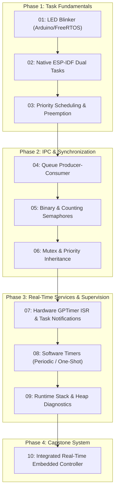

# RTOS Journey


> **Hands-on embedded firmware engineering repository** documenting progressive real-time systems development using **FreeRTOS** on the **Espressif ESP32** microcontroller with **ESP-IDF v6.1**.

---

## Overview

**RTOS Journey** is a structured, production-grade learning roadmap exploring Real-Time Operating Systems (RTOS) from foundational task creation to advanced inter-task communication, synchronization, deferred interrupt processing, software timers, runtime memory monitoring, and integrated controller architecture.

Every project is fully modular, independently buildable under ESP-IDF v6.1, validated on physical hardware, and documented with architectural workflows, timing diagrams, FreeRTOS API references, and verified build-time memory footprints.

---

## Hardware & Toolchain Environment

| Component | Target Specification |
| :--- | :--- |
| **Silicon Platform** | Espressif ESP32-WROOM-32 (Xtensa Dual-Core 32-bit LX6 @ 240 MHz) |
| **Internal Memory** | 520 KB SRAM (organized into IRAM and DRAM regions) |
| **Flash Memory** | 4 MB Quad-SPI Flash |
| **RTOS Kernel** | FreeRTOS SMP Port (Espressif ESP-IDF FreeRTOS implementation) |
| **Framework** | Native ESP-IDF v6.1 (with Project 01 covering Arduino-ESP32 bridging) |
| **Build System** | CMake 3.22+ and Ninja build backend |
| **Compiler** | `xtensa-esp-elf-gcc` (ESP-IDF toolchain) |
| **Telemetry / Console** | UART @ 115200 baud, 8-N-1 |

---

## Architectural Progression



---

## Project Repository Index

| Project | Name & Directory | Primary Concept | Core FreeRTOS APIs | Status |
| :---: | :--- | :--- | :--- | :---: |
| **01** | [01_ESP32_FreeRTOS_LED_Blink](./01_ESP32_FreeRTOS_LED_Blink/) | Transition from bare-metal delay to RTOS tasks | `xTaskCreate`, `vTaskDelay`, `pdMS_TO_TICKS` | Completed |
| **02** | [02_ESP32_Native_ESP_IDF_Multiple_Tasks](./02_ESP32_Native_ESP_IDF_Multiple_Tasks/) | Native ESP-IDF dual-task concurrency & GPIO | `app_main`, `xTaskCreate`, `gpio_set_level` | Completed |
| **03** | [03_Task_Scheduling_Priorities](./03_Task_Scheduling_Priorities/) | Deterministic priority-based preemption & starvation avoidance | `xTaskCreate`, `vTaskDelay`, priorities 1–3 | Completed |
| **04** | [04_Queue_Producer_Consumer](./04_Queue_Producer_Consumer/) | Thread-safe inter-task FIFO message passing & backpressure | `xQueueCreate`, `xQueueSend`, `xQueueReceive` | Completed |
| **05** | [05_Binary_Counting_Semaphores](./05_Binary_Counting_Semaphores/) | Event signaling (binary) & event burst tracking (counting) | `xSemaphoreCreateBinary`, `xSemaphoreCreateCounting` | Completed |
| **06** | [06_Mutex_Resource_Management](./06_Mutex_Resource_Management/) | Shared resource mutual exclusion & priority inheritance | `xSemaphoreCreateMutex`, `xSemaphoreTake`, `xSemaphoreGive` | Completed |
| **07** | [07_Interrupt_Event_Processing](./07_Interrupt_Event_Processing/) | Hardware GPTimer deferred interrupt handling | `gptimer_new_timer`, `vTaskNotifyGiveFromISR`, `ulTaskNotifyTake` | Completed |
| **08** | [08_FreeRTOS_Software_Timers](./08_FreeRTOS_Software_Timers/) | Non-blocking periodic and one-shot timer service daemon | `xTimerCreate`, `xTimerStart`, `xTimerStop` | Completed |
| **09** | [09_Runtime_Monitoring](./09_Runtime_Monitoring/) | Stack high-water mark & dynamic heap supervision | `uxTaskGetStackHighWaterMark`, `esp_get_free_heap_size` | Completed |
| **10** | [10_Integrated_RTOS_Controller](./10_Integrated_RTOS_Controller/) | Full production architecture integrating queues, mutexes & alerts | Full FreeRTOS suite, 4-tier task architecture | Completed |

---

## FreeRTOS Concepts & API Matrix

| FreeRTOS Mechanism | Projects Utilizing | Key Functions & Types | Engineering Value |
| :--- | :--- | :--- | :--- |
| **Task Lifecycle & Creation** | 01, 02, 03, 04, 05, 06, 07, 08, 09, 10 | `xTaskCreate()`, `vTaskDelete()` | Allocates TCB and private stack; enables deterministic multitasking |
| **Blocking Delays** | 01, 02, 03, 04, 05, 06, 08, 09, 10 | `vTaskDelay()`, `pdMS_TO_TICKS()` | Relinquishes CPU time slices to allow lower-priority tasks to run |
| **Message Queues** | 04, 10 | `xQueueCreate()`, `xQueueSend()`, `xQueueReceive()` | Safe copy-by-value IPC without shared memory race hazards |
| **Binary Semaphores** | 05, 10 | `xSemaphoreCreateBinary()`, `xSemaphoreGive()`, `xSemaphoreTake()` | Unblocks consumer tasks upon discrete hardware/software events |
| **Counting Semaphores** | 05 | `xSemaphoreCreateCounting()` | Queues multiple pending event tokens without dropping transient pulses |
| **Mutexes & Priority Inheritance** | 06, 10 | `xSemaphoreCreateMutex()`, `xSemaphoreTake()`, `xSemaphoreGive()` | Protects shared variables while preventing unbounded priority inversion |
| **Task Notifications** | 07, 10 | `vTaskNotifyGiveFromISR()`, `xTaskNotifyGive()`, `ulTaskNotifyTake()` | Ultra-fast direct task signaling with zero auxiliary heap allocation |
| **Software Timers** | 08, 10 | `xTimerCreate()`, `xTimerStart()`, `xTimerStop()` | Executes asynchronous callbacks via the timer service daemon |
| **Memory Diagnostics** | 09, 10 | `uxTaskGetStackHighWaterMark()`, `esp_get_free_heap_size()` | Verifies stack safety margins and prevents catastrophic runtime crashes |

---

## Consolidated Build Memory Comparison (Projects 03–10)

The table below summarizes the **verified build-time memory reports** across Projects 03 through 10 on ESP-IDF v6.1 targeting the ESP32.

> **Important**: These figures reflect static compiler allocations across target binary segments (`.text`, `.rodata`, `.data`, `.bss`). They are distinct from runtime dynamic memory (task stacks and FreeRTOS heap allocations allocated during execution).

| Project | Flash Code (bytes) | IRAM Used / Cap (bytes) | IRAM % | Flash Data (bytes) | DRAM Used / Cap (bytes) | DRAM % | RTC SLOW / Cap (bytes) | RTC % | Total Binary Image |
| :--- | :---: | :---: | :---: | :---: | :---: | :---: | :---: | :---: | :---: |
| **03: Task Scheduling** | 51,894 | 44,031 / 131,072 | 33.59% | 35,548 | 13,618 / 180,736 | 7.53% | 64 / 8,192 | 0.78% | **142,531 bytes** |
| **04: Queue Producer-Consumer** | 52,402 | 44,031 / 131,072 | 33.59% | 35,788 | 13,618 / 180,736 | 7.53% | 64 / 8,192 | 0.78% | **143,279 bytes** |
| **05: Semaphores** | 52,358 | 44,031 / 131,072 | 33.59% | 36,076 | 13,626 / 180,736 | 7.54% | 64 / 8,192 | 0.78% | **143,523 bytes** |
| **06: Mutex Management** | 52,126 | 44,031 / 131,072 | 33.59% | 35,724 | 13,626 / 180,736 | 7.54% | 64 / 8,192 | 0.78% | **142,939 bytes** |
| **07: Interrupt Processing** | 53,622 | 44,395 / 131,072 | 33.87% | 35,940 | 13,930 / 180,736 | 7.71% | 64 / 8,192 | 0.78% | **145,015 bytes** |
| **08: Software Timers** | 53,622 | 44,395 / 131,072 | 33.87% | 35,940 | 13,930 / 180,736 | 7.71% | 64 / 8,192 | 0.78% | **145,015 bytes** |
| **09: Runtime Monitoring** | 52,534 | 44,031 / 131,072 | 33.59% | 35,820 | 13,618 / 180,736 | 7.53% | 64 / 8,192 | 0.78% | **143,443 bytes** |
| **10: Integrated Controller** | 54,618 | 44,395 / 131,072 | 33.87% | 36,628 | 13,954 / 180,736 | 7.72% | 64 / 8,192 | 0.78% | **146,699 bytes** |

---

## Installation & Setup Instructions

### Prerequisites
1. **ESP-IDF v6.1**: Installed and configured with environment variables loaded (`export.sh` or `export.ps1`).
2. **Git**: Installed on host workstation.
3. **Hardware**: ESP32-WROOM-32 development board connected via Micro-USB / USB-C.

### Workspace Setup
Clone the repository recursively:
```bash
git clone https://github.com/PRIY4DH4RS4N-D/RTOS-Journey.git
cd RTOS-Journey
```

Load the ESP-IDF environment in your active terminal:
```powershell
# Windows PowerShell
. $HOME/esp/esp-idf/export.ps1

# Linux / macOS Bash
. $HOME/esp/esp-idf/export.sh
```

---

## Build, Flash & Monitor Workflow

Any project (02 through 10) can be compiled and flashed independently from its dedicated directory:

```bash
# Navigate to target project folder (e.g. Project 10)
cd 10_Integrated_RTOS_Controller

# Set target microcontroller
idf.py set-target esp32

# Compile the firmware
idf.py build

# Flash to the board (replace COMx or /dev/ttyUSB0 with your port)
idf.py -p COM12 flash

# Launch the interactive serial monitor
idf.py -p COM12 monitor
```

To exit the serial monitor, press `Ctrl + ]`.

---

## Technical Learning Outcomes

1. **Preemptive Real-Time Scheduling**: Gained practical understanding of tick interrupts, priority preemption, and the critical distinction between cooperative delays (`vTaskDelay`) and CPU-saturating busy loops.
2. **Deterministic Inter-Task Synchronization**: Mastered proper primitive selection: queues for multi-field data transfers, binary semaphores for unblocking single waiting tasks, counting semaphores for tracking resource pools, and mutexes for guarded shared variables.
3. **Interrupt Safety (Top-Half / Bottom-Half)**: Implemented lean ISR routines with `FromISR` primitives, eliminating heavy execution in interrupt context by deferring to prioritized worker tasks.
4. **Memory Hygiene & Defensiveness**: Applied high-water mark diagnostics to right-size task stacks, and tracked heap depletion to prevent memory leakage in long-running firmware.
5. **System Integration**: Combined multiple concurrent sub-systems into a cohesive, fault-tolerant embedded control system.

---

## Future Improvement Opportunities

- **Dual-Core Affinity Optimization**: Pin compute-heavy DSP tasks to Core 1 while dedicating Core 0 to real-time wireless protocol stacks (`xTaskCreatePinnedToCore`).
- **Static Memory Allocation**: Migrate from dynamic RTOS memory (`xTaskCreate`) to fully deterministic static allocation (`xTaskCreateStatic`, `xQueueCreateStatic`) for mission-critical safety compliance (MISRA-C / ISO 26262).
- **Event Groups & Stream Buffers**: Introduce FreeRTOS event groups (`xEventGroupWaitBits`) for multi-condition synchronization and stream buffers for variable-length UART/DMA pipelines.
- **Low-Power Tickless Idle**: Enable `CONFIG_FREERTOS_USE_TICKLESS_IDLE` to suppress periodic timer ticks during sleep, extending battery life on remote IoT nodes.

---

## Repository Structure

```text
RTOS-Journey/
├── 01_ESP32_FreeRTOS_LED_Blink/             # Experiment 01: Arduino-ESP32 baseline
├── 02_ESP32_Native_ESP_IDF_Multiple_Tasks/  # Experiment 02: Native ESP-IDF dual-task
├── 03_Task_Scheduling_Priorities/           # Project 03: Task priorities & preemption
├── 04_Queue_Producer_Consumer/              # Project 04: Queue message buffering
├── 05_Binary_Counting_Semaphores/           # Project 05: Binary & counting semaphores
├── 06_Mutex_Resource_Management/            # Project 06: Mutex & priority inheritance
├── 07_Interrupt_Event_Processing/           # Project 07: GPTimer ISR & task notifications
├── 08_FreeRTOS_Software_Timers/             # Project 08: Software timer service daemon
├── 09_Runtime_Monitoring/                   # Project 09: Stack high-water mark & heap monitoring
├── 10_Integrated_RTOS_Controller/           # Project 10: Capstone integrated controller
├── assets/                                  # Architectural SVG diagrams
├── LICENSE                                  # MIT License
└── README.md                                # Root documentation & memory matrix
```

---

## Author & Maintainer

**Priyadharsan D**
- GitHub: [@PRIY4DH4RS4N-D](https://github.com/PRIY4DH4RS4N-D)
- Focus: Embedded Firmware Engineering, Real-Time Operating Systems (RTOS), ESP32 / ARM Cortex-M Systems

---

## License

This repository is licensed under the [MIT License](./LICENSE). Feel free to reference, adapt, and build upon these experiments for research and embedded firmware development.
