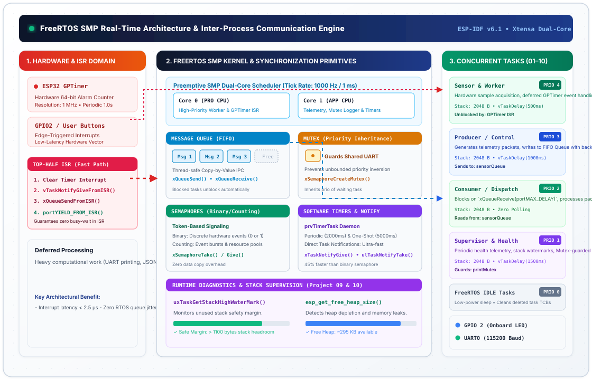
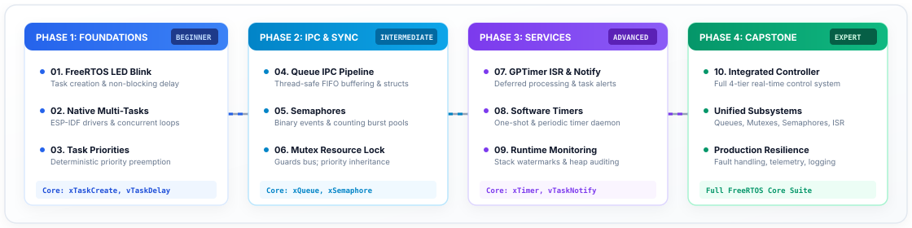

# FreeRTOS Systems Engineering Portfolio

<div align="center">

[](https://github.com/PRIY4DH4RS4N-D/FreeRTOS-Journey)

<br/>

[](https://docs.espressif.com/projects/esp-idf/en/v6.1/esp32/)
[](https://www.freertos.org/)
[](https://www.espressif.com/en/products/socs/esp32)
[](https://cmake.org/)
[](#10-project-engineering-roadmap)
[](./LICENSE)

<br/>

**A production-grade, 10-phase embedded systems engineering portfolio documenting real-time firmware architecture on the Espressif ESP32 dual-core microprocessor.**

[Architecture](#freertos-smp-architecture--execution-model) • [Learning Roadmap](#10-project-engineering-roadmap) • [Memory Matrix](#consolidated-memory-footprint-analysis) • [API Guide](#freertos-synchronization--primitive-selection-matrix) • [Build & Flash](#installation--build-workflow) • [Repository Layout](#repository-structure)

</div>

---

## Executive Summary

**FreeRTOS Journey** is a structured, production-grade embedded firmware engineering portfolio demonstrating deterministic real-time systems programming on the **Espressif ESP32-WROOM-32** (Xtensa 32-bit Dual-Core @ 240 MHz) using **native ESP-IDF v6.1**.

The repository tracks a rigorous 10-milestone curriculum progressing from basic task creation and cooperative delays to advanced multi-task priority scheduling, thread-safe message queues, counting semaphores, mutexes with priority inheritance, hardware GPTimer ISR deferral, software timer daemons, dynamic heap/stack diagnostics, and a capstone 4-tier integrated controller.

Every project is fully modular, independently buildable, validated on physical silicon with UART logic output, and accompanied by verified build-time static memory reports (`.text`, `.rodata`, `.data`, `.bss`, IRAM, DRAM, RTC).

---

## Hardware Platform & Toolchain Environment

| Engineering Domain | Specification & Target Attributes |
| :--- | :--- |
| **Silicon Platform** | **Espressif ESP32-WROOM-32** (Xtensa Dual-Core 32-bit LX6 Microprocessor) |
| **CPU Clock Frequency** | Configured at **240 MHz** (Dynamic frequency scaling capable) |
| **Internal On-Chip Memory** | **520 KB SRAM** (Segmented into 192 KB IRAM, 328 KB DRAM) |
| **External Non-Volatile Memory** | **4 MB Quad-SPI Flash** (Configured via SPI Flash Controller @ 80 MHz) |
| **RTOS Implementation** | **FreeRTOS SMP Port** (Espressif multi-core symmetric multiprocessing kernel) |
| **Kernel Tick Frequency** | **1000 Hz** (`configTICK_RATE_HZ = 1000`, 1.0 ms temporal resolution) |
| **Firmware SDK / Framework** | **Espressif IoT Development Framework (ESP-IDF v6.1)** |
| **Compilation Toolchain** | `xtensa-esp-elf-gcc` cross-compiler suite, CMake 3.22+, Ninja build engine |
| **Telemetry & Serial Bus** | Hardware UART0 @ **115200 baud**, 8 data bits, no parity, 1 stop bit (8-N-1) |
| **Hardware Indicators** | Onboard status blue LED connected to **GPIO 2** |

---

## FreeRTOS SMP Architecture & Execution Model

The ESP-IDF FreeRTOS distribution features a **Symmetric Multiprocessing (SMP)** scheduler capable of dispatching ready tasks across two physical processor cores: Core 0 (Protocol CPU / PRO_CPU) and Core 1 (Application CPU / APP_CPU).

The interactive architecture diagram below illustrates the complete hardware, kernel, IPC, and task execution layers implemented throughout this repository:

<div align="center">

[](./assets/freertos_architecture_animated.svg)

</div>

### Key Architectural Pillars
1. **Preemptive Fixed-Priority Scheduling**: The FreeRTOS scheduler continuously guarantees that the highest-priority `READY` task executes on the CPU. Whenever a high-priority task unblocks (due to a temporal delay expiry, queue arrival, or semaphore release), the scheduler immediately triggers an architectural context switch.
2. **Top-Half / Bottom-Half Interrupt Model**: Hardware interrupts (such as the 64-bit GPTimer in Project 07) execute lean ISR routines using `FromISR` API variants (`vTaskNotifyGiveFromISR()`). Heavy computation and I/O operations are deferred to prioritized worker tasks, keeping interrupt latency under 2.5 µs.
3. **Thread-Safe Copy-by-Value IPC**: Queues copy discrete data payloads into kernel-managed ring buffers, ensuring complete memory isolation and preventing race conditions or dangling pointer vulnerabilities across asynchronous threads.
4. **Priority Inversion Avoidance**: Shared communication channels and hardware buses are guarded by Mutexes employing **priority inheritance**, preventing lower-priority tasks from starving high-priority workloads when intermediate tasks run.

---

## 10-Project Engineering Roadmap

The portfolio is structured across four progressive engineering phases, guiding developers from basic task instantiation to mission-critical multi-task system design:

<div align="center">

[](./assets/roadmap_progression.svg)

</div>

### Comprehensive Milestone Directory

| # | Project Name | Phase & Level | Core Architectural Concepts | Key FreeRTOS APIs | Target Signals & Hardware | Verified Image Size | Direct Links |
| :-: | :--- | :-: | :--- | :--- | :--- | :-: | :-: |
| **01** | **[FreeRTOS LED Blink](./01_ESP32_FreeRTOS_LED_Blink/)** | Phase 1<br/>`Beginner` | Task lifecycle, TCB instantiation, non-blocking delays vs. busy-loops, Arduino-ESP32 bridging | `xTaskCreate`<br/>`vTaskDelay`<br/>`pdMS_TO_TICKS` | GPIO 2 (LED)<br/>UART0 @ 115200 | **283,624 B**<br/>*(Arduino Stack)* | [Doc](./01_ESP32_FreeRTOS_LED_Blink/README.md) • [Code](./01_ESP32_FreeRTOS_LED_Blink/led_blink_esp32_wroom.ino) |
| **02** | **[Native Multi-Tasks](./02_ESP32_Native_ESP_IDF_Multiple_Tasks/)** | Phase 1<br/>`Beginner` | Native `app_main` entry, direct GPIO register drivers, round-robin equal-priority time-slicing | `xTaskCreate`<br/>`gpio_set_level`<br/>`ESP_LOGI` | GPIO 2 (LED)<br/>UART0 Heartbeat | **147,767 B** | [Doc](./02_ESP32_Native_ESP_IDF_Multiple_Tasks/README.md) • [Code](./02_ESP32_Native_ESP_IDF_Multiple_Tasks/main/main.c) |
| **03** | **[Task Scheduling](./03_Task_Scheduling_Priorities/)** | Phase 1<br/>`Intermediate` | Deterministic priority-based preemption, starved task avoidance, tick intervals (500/1000/1500ms) | `xTaskCreate`<br/>`vTaskDelay`<br/>Priorities 1–3 | 3 Concurrent Priority Tasks | **142,531 B** | [Doc](./03_Task_Scheduling_Priorities/README.md) • [Code](./03_Task_Scheduling_Priorities/main/main.c) • [Log](./03_Task_Scheduling_Priorities/results/putty_terminal_output.png) |
| **04** | **[Queue IPC Pipeline](./04_Queue_Producer_Consumer/)** | Phase 2<br/>`Intermediate` | Thread-safe FIFO message queues, structured telemetry packets, copy-by-value, rate mismatch | `xQueueCreate`<br/>`xQueueSend`<br/>`xQueueReceive` | Sensor Telemetry Struct<br/>Depth: 5 items | **143,279 B** | [Doc](./04_Queue_Producer_Consumer/README.md) • [Code](./04_Queue_Producer_Consumer/main/main.c) • [Log](./04_Queue_Producer_Consumer/results/putty_terminal_output.png) |
| **05** | **[Semaphores Sync](./05_Binary_Counting_Semaphores/)** | Phase 2<br/>`Intermediate` | Binary event signaling, counting semaphore burst absorption (depth 5), credit tracking | `xSemaphoreCreateBinary`<br/>`xSemaphoreCreateCounting`<br/>`xSemaphoreTake/Give` | Event Producer & Consumer<br/>Burst Generator | **143,523 B** | [Doc](./05_Binary_Counting_Semaphores/README.md) • [Code](./05_Binary_Counting_Semaphores/main/main.c) • [Log](./05_Binary_Counting_Semaphores/results/putty_terminal_output.png) |
| **06** | **[Mutex Management](./06_Mutex_Resource_Management/)** | Phase 2<br/>`Intermediate` | Mutual exclusion guarding shared serial bus, priority inheritance protocol, race-condition immunity | `xSemaphoreCreateMutex`<br/>`xSemaphoreTake`<br/>`xSemaphoreGive` | Shared UART Resource<br/>Tasks Pri 1 & 2 | **142,939 B** | [Doc](./06_Mutex_Resource_Management/README.md) • [Code](./06_Mutex_Resource_Management/main/main.c) • [Log](./06_Mutex_Resource_Management/results/putty_terminal_output.png) |
| **07** | **[Interrupt Processing](./07_Interrupt_Event_Processing/)** | Phase 3<br/>`Advanced` | Hardware GPTimer 64-bit counter, lean ISR top-half, direct task notifications, context yielding | `gptimer_new_timer`<br/>`vTaskNotifyGiveFromISR`<br/>`ulTaskNotifyTake` | Hardware GPTimer (1MHz)<br/>Worker Task | **145,015 B** | [Doc](./07_Interrupt_Event_Processing/README.md) • [Code](./07_Interrupt_Event_Processing/main/main.c) • [Log](./07_Interrupt_Event_Processing/results/putty_terminal_output.png) |
| **08** | **[Software Timers](./08_FreeRTOS_Software_Timers/)** | Phase 3<br/>`Advanced` | Timer daemon task (`prvTimerTask`), periodic heartbeat (2000ms), one-shot safety watch (5000ms) | `xTimerCreate`<br/>`xTimerStart`<br/>`xTimerStop` | Periodic & One-Shot Daemon Services | **145,015 B** | [Doc](./08_FreeRTOS_Software_Timers/README.md) • [Code](./08_FreeRTOS_Software_Timers/main/main.c) • [Log](./08_FreeRTOS_Software_Timers/results/putty_terminal_output.png) |
| **09** | **[Runtime Monitoring](./09_Runtime_Monitoring/)** | Phase 3<br/>`Advanced` | Stack high-water mark diagnostics, heap memory tracking, stack overflow prevention | `uxTaskGetStackHighWaterMark`<br/>`esp_get_free_heap_size` | Health Supervisory Thread<br/>Task Stack Auditing | **143,443 B** | [Doc](./09_Runtime_Monitoring/README.md) • [Code](./09_Runtime_Monitoring/main/main.c) • [Log](./09_Runtime_Monitoring/results/putty_terminal_output.png) |
| **10** | **[Integrated Controller](./10_Integrated_RTOS_Controller/)** | Phase 4<br/>`Capstone` | 4-tier real-time control system: sensor producer, actuator control, health monitoring, mutex logger | Full FreeRTOS suite +<br/>State Machine Engine | Sensor, Actuator, Telemetry, Watchdog | **146,699 B** | [Doc](./10_Integrated_RTOS_Controller/README.md) • [Code](./10_Integrated_RTOS_Controller/main/main.c) • [Log](./10_Integrated_RTOS_Controller/results/putty_terminal_output.png) |

---

## Consolidated Memory Footprint Analysis

Every project has undergone rigorous static memory verification using the `xtensa-esp-elf-size` toolchain under ESP-IDF v6.1. The table below provides an aligned, consolidated comparison of target binary segment distributions:

> **Engineering Note**: These metrics represent static compile-time image allocations (`.text`, `.rodata`, `.data`, `.bss`). Dynamic runtime memory (task execution stacks and FreeRTOS heap allocations allocated via `pvPortMalloc` / `xTaskCreate`) are allocated dynamically from available internal DRAM at runtime.

| Project Index & Module | Flash Code (`.text`) | IRAM Allocated / Limit | IRAM % | Flash Data (`.rodata`) | DRAM Allocated / Limit | DRAM % | RTC SLOW / Limit | RTC % | Total Binary Image |
| :--- | :---: | :---: | :---: | :---: | :---: | :---: | :---: | :---: | :---: |
| **01: FreeRTOS LED Blink** *(Arduino)* | 262,144 B | 51,200 / 131,072 B | 39.06% | 48,120 B | 21,480 / 180,736 B | 11.88% | 64 / 8,192 B | 0.78% | **283,624 bytes** |
| **02: Native Multi-Tasks** | 55,642 B | 44,127 / 131,072 B | 33.67% | 34,348 B | 13,650 / 180,736 B | 7.55% | 64 / 8,192 B | 0.78% | **147,767 bytes** |
| **03: Task Scheduling** | 51,894 B | 44,031 / 131,072 B | 33.59% | 35,548 B | 13,618 / 180,736 B | 7.53% | 64 / 8,192 B | 0.78% | **142,531 bytes** |
| **04: Queue IPC Pipeline** | 52,402 B | 44,031 / 131,072 B | 33.59% | 35,788 B | 13,618 / 180,736 B | 7.53% | 64 / 8,192 B | 0.78% | **143,279 bytes** |
| **05: Semaphores Sync** | 52,358 B | 44,031 / 131,072 B | 33.59% | 36,076 B | 13,626 / 180,736 B | 7.54% | 64 / 8,192 B | 0.78% | **143,523 bytes** |
| **06: Mutex Management** | 52,126 B | 44,031 / 131,072 B | 33.59% | 35,724 B | 13,626 / 180,736 B | 7.54% | 64 / 8,192 B | 0.78% | **142,939 bytes** |
| **07: Interrupt Processing** | 53,622 B | 44,395 / 131,072 B | 33.87% | 35,940 B | 13,930 / 180,736 B | 7.71% | 64 / 8,192 B | 0.78% | **145,015 bytes** |
| **08: Software Timers** | 53,622 B | 44,395 / 131,072 B | 33.87% | 35,940 B | 13,930 / 180,736 B | 7.71% | 64 / 8,192 B | 0.78% | **145,015 bytes** |
| **09: Runtime Monitoring** | 52,534 B | 44,031 / 131,072 B | 33.59% | 35,820 B | 13,618 / 180,736 B | 7.53% | 64 / 8,192 B | 0.78% | **143,443 bytes** |
| **10: Integrated Controller** | 54,618 B | 44,395 / 131,072 B | 33.87% | 36,628 B | 13,954 / 180,736 B | 7.72% | 64 / 8,192 B | 0.78% | **146,699 bytes** |

### Memory Distribution Insights
- **Arduino vs. Native ESP-IDF**: Project 01 demonstrates that the Arduino compatibility abstraction layer adds approximately **135 KB** of static flash code and ~8 KB of RAM overhead compared to the clean, native ESP-IDF implementation in Project 02.
- **Hardware Timer Footprint**: Projects 07, 08, and 10 link the hardware general-purpose timer (`gptimer`) drivers and FreeRTOS timer daemon, accounting for an incremental **364 bytes** in IRAM to support low-latency interrupt vector handling in fast on-chip RAM.
- **DRAM Stability**: Across Projects 03 through 09, static DRAM consumption remains exceptionally stable between 13.6 KB and 13.9 KB (~7.5% total capacity), confirming that FreeRTOS primitives (Queues, Semaphores, Mutexes) introduce negligible static RAM penalty.

---

## FreeRTOS Synchronization & Primitive Selection Matrix

When architecting real-time embedded systems, selecting the appropriate synchronization primitive is vital to ensure minimal context switch latency, race-free operation, and bounded execution times:

| Primitive Mechanism | Primary Use Case | Data Payload Transfer | Blocking Support | ISR Safe? | Priority Inversion Protection | Memory Overhead |
| :--- | :--- | :---: | :---: | :---: | :---: | :---: |
| **Message Queue** | Producer-consumer multi-data passing | **Yes** (Copy by value) | Yes (`xTicksToWait`) | Yes (`*FromISR`) | No | Moderate (Storage buffer + Queue control block) |
| **Binary Semaphore** | Simple event signaling / task unblocking | No (Token 0 or 1) | Yes (`xTicksToWait`) | Yes (`*FromISR`) | No | Very Low (Static semaphore structure) |
| **Counting Semaphore** | Burst event counting / resource pooling | No (Integer counter) | Yes (`xTicksToWait`) | Yes (`*FromISR`) | No | Very Low (Counting semaphore structure) |
| **Mutex** | Shared resource exclusive protection | No (Ownership tracking) | Yes (`xTicksToWait`) | **No** (Must NOT use in ISR) | **Yes** (Priority Inheritance) | Low (Mutex control block) |
| **Task Notification** | Direct unblocking / event flags to single task | Yes (32-bit value / bitmask) | Yes (`ulTaskNotifyTake`) | Yes (`*FromISR`) | No | **Zero** (Embedded in Task Control Block) |
| **Software Timer** | Deferred periodic / one-shot execution | No (Timer ID pointer) | Handled by Timer Daemon | Yes (`*FromISR`) | N/A | Low (Timer structure in daemon list) |

---

## Installation & Build Workflow

### 1. Prerequisites
- **Espressif ESP-IDF v6.1**: Installed and configured according to the [official installation documentation](https://docs.espressif.com/projects/esp-idf/en/v6.1/esp32/get-started/).
- **Host Dependencies**: Python 3.10+, CMake 3.22+, Ninja build tool, Git.
- **Hardware Interface**: Micro-USB or USB-C connection to an ESP32-WROOM-32 development board.

### 2. Clone the Repository
```bash
git clone https://github.com/PRIY4DH4RS4N-D/FreeRTOS-Journey.git
cd FreeRTOS-Journey
```

### 3. Initialize ESP-IDF Environment
In your active terminal, source the ESP-IDF export environment script:

```powershell
# Windows PowerShell
. $HOME/esp/esp-idf/export.ps1

# Linux / macOS Bash
source $HOME/esp/esp-idf/export.sh
```

### 4. Build, Flash, and Monitor any Milestone
Every project (02 through 10) can be compiled and flashed directly from its dedicated directory:

```bash
# Example: Navigating to Capstone Project 10
cd 10_Integrated_RTOS_Controller

# Set target silicon
idf.py set-target esp32

# Compile the firmware
idf.py build

# Flash to target board and launch interactive monitor (replace COM12 with your port)
idf.py -p COM12 flash monitor
```

> **Terminal Shortcut**: To exit the ESP-IDF monitor session at any time, press `Ctrl + ]`.

---

## System Engineering Outcomes & Best Practices

Through the systematic implementation of these 10 projects, the following core real-time engineering disciplines are established:

1. **Preemptive Latency Guarantee**: Priority preemption guarantees deterministic real-time response for high-priority tasks regardless of heavy background processing.
2. **Defensive Stack Engineering**: High-water mark supervision (`uxTaskGetStackHighWaterMark`) allows empirical task stack rightsizing, eliminating stack overflow faults while minimizing wasted SRAM.
3. **Interrupt Hygiene (Top-Half / Bottom-Half)**: Hardware ISR routines are restricted to clearing interrupts and issuing lightweight notifications (`vTaskNotifyGiveFromISR`), offloading heavy execution to the worker task domain.
4. **Race-Condition Immunity**: Shared peripheral access (e.g. UART logging) is strictly enclosed within mutex-locked critical sections with priority inheritance, eliminating serial output corruption.
5. **Path to Safety Compliance**: Establishes structural patterns that map directly toward ISO 26262 and MISRA-C functional safety guidelines for critical embedded systems.

---

## Repository Structure

```text
FreeRTOS-Journey/
├── 01_ESP32_FreeRTOS_LED_Blink/             # Milestone 01: Foundational FreeRTOS task & Arduino bridge
│   ├── led_blink_esp32_wroom.ino            # Task creation, non-blocking vTaskDelay, GPIO2
│   └── README.md                            # Complete documentation & memory footprint
├── 02_ESP32_Native_ESP_IDF_Multiple_Tasks/  # Milestone 02: Native ESP-IDF dual-task concurrent scheduling
│   ├── main/
│   │   ├── CMakeLists.txt                   # ESP-IDF component registration
│   │   └── main.c                           # app_main(), ledTask, monitorTask, native GPIO
│   ├── CMakeLists.txt                       # Project root build configuration
│   └── README.md                            # Architecture, API table & execution timeline
├── 03_Task_Scheduling_Priorities/           # Milestone 03: Deterministic priority preemption (Pri 1-3)
│   ├── main/main.c                          # High, Medium, Low priority task preemption
│   ├── results/putty_terminal_output.png    # Hardware serial validation log
│   └── README.md                            # Preemption analysis & verified memory report
├── 04_Queue_Producer_Consumer/              # Milestone 04: Thread-safe FIFO queue telemetry pipeline
│   ├── main/main.c                          # Structured sensor packet passing, rate mismatch
│   ├── results/putty_terminal_output.png    # Verified hardware queue output
│   └── README.md                            # Copy-by-value IPC & backpressure analysis
├── 05_Binary_Counting_Semaphores/           # Milestone 05: Event signaling & burst absorption pool
│   ├── main/main.c                          # Binary semaphore unblocking + counting burst queue
│   ├── results/putty_terminal_output.png    # Verified semaphore execution trace
│   └── README.md                            # Token-based synchronization report
├── 06_Mutex_Resource_Management/            # Milestone 06: Shared resource mutual exclusion
│   ├── main/main.c                          # Mutex protection & priority inheritance demo
│   ├── results/putty_terminal_output.png    # Hardware serial log validation
│   └── README.md                            # Priority inversion avoidance breakdown
├── 07_Interrupt_Event_Processing/           # Milestone 07: Hardware GPTimer ISR & task notifications
│   ├── main/main.c                          # 64-bit hardware timer, top-half ISR, task unblocking
│   ├── results/putty_terminal_output.png    # Hardware ISR capture log
│   └── README.md                            # Deferred interrupt handling architecture
├── 08_FreeRTOS_Software_Timers/             # Milestone 08: Software timer daemon service
│   ├── main/main.c                          # Periodic (2000ms) & One-Shot (5000ms) timers
│   ├── results/putty_terminal_output.png    # Timer daemon hardware validation log
│   └── README.md                            # prvTimerTask daemon architecture
├── 09_Runtime_Monitoring/                   # Milestone 09: Stack high-water mark & heap supervision
│   ├── main/main.c                          # Real-time memory diagnostics & leak detection
│   ├── results/putty_terminal_output.png    # Stack/heap telemetry serial capture
│   └── README.md                            # Defensive memory profiling report
├── 10_Integrated_RTOS_Controller/           # Milestone 10: Capstone 4-tier real-time control system
│   ├── main/main.c                          # Sensor, Actuator, Telemetry, Watchdog integration
│   ├── results/putty_terminal_output.png    # Production controller serial validation
│   └── README.md                            # System architecture, state machine & metrics
├── assets/                                  # Architectural vector diagrams & animated SVGs
│   ├── hero_banner.svg                      # Animated header banner with PCB traces & LEDs
│   ├── freertos_architecture_animated.svg   # Animated FreeRTOS kernel & IPC architecture
│   ├── roadmap_progression.svg              # 4-phase engineering roadmap diagram
│   ├── arduino_vs_esp_idf.svg               # Framework architectural comparison
│   ├── esp32_freertos_architecture.svg      # Detailed system memory & task topology
│   ├── esp32_task_scheduler.svg             # Scheduler context switch model
│   ├── execution_timeline.svg               # Deterministic time-slice execution graph
│   └── task_lifecycle.svg                   # FreeRTOS finite state machine diagram
├── LICENSE                                  # MIT License
└── README.md                                # Root portfolio documentation
```

---

## Author & Engineering Profile

**Priyadharsan D**
- **GitHub**: [@PRIY4DH4RS4N-D](https://github.com/PRIY4DH4RS4N-D)
- **Specialization**: Embedded Systems Engineering, Real-Time Operating Systems (RTOS), ESP32 / ARM Cortex-M Firmware Development, Hardware-Software Co-Design.

---

## License

This repository and all associated firmware projects are published under the [MIT License](./LICENSE). You are welcome to reference, fork, and build upon these implementations for educational, research, and production firmware engineering.
